# my-ai-skills

[Português (Brasil)](README.md) · English

Reusable skills and tools for a supervised, issue-driven AI software development lifecycle using GitHub, OpenSpec, ChatGPT, Codex, Claude and Claude Code.

The repository defines one shared protocol across two operating layers:

- **Web / coordination:** requirements, decisions, architecture, contract handoff and independent review.
- **CLI / execution:** repository exploration, OpenSpec, implementation, tests, PR preparation and review fixes.

GitHub is the source of truth. Material decisions must end up in an issue, PR, architecture document, OpenSpec artifact or code—not only in chat history.

## Contents

- [Workflow](#lifecycle)
- [Skills overview](#skills)
- [Web supervision](#web-supervision)
- [Configure the Web agent project](#configure-the-web-agent-project)
- [Implement approved designs](#implementing-approved-ui-designs)
- [GitHub protocol](#github-protocol)
- [Helper scripts](#helper-scripts)
- [Timing metrics](#workflow-timing-metrics)
- [Step-by-step installation](#step-by-step-installation)
- [Install as a personal plugin](#install-as-a-personal-chatgptcodex-plugin)
- [Taking care of one issue](#taking-care-of-one-issue)
- [Milestone operating rules](#milestone-operating-rules)
- [Cross-repository flow](#recommended-cross-repository-flow)
- [CI optimization](#automatic-ci-performance-improvement)

## Lifecycle

The workflow starts with the Web agent: describe your need, and the skills inspect context and create/refine the GitHub issue. The CLI agent then receives the issue or milestone and handles planning, implementation and review.

The lifecycle moves through discovery, readiness, implementation, review and completion. OpenSpec is required; `openspec-workflow` governs exploration, proposals, exact-revision validation, implementation verification and archive.

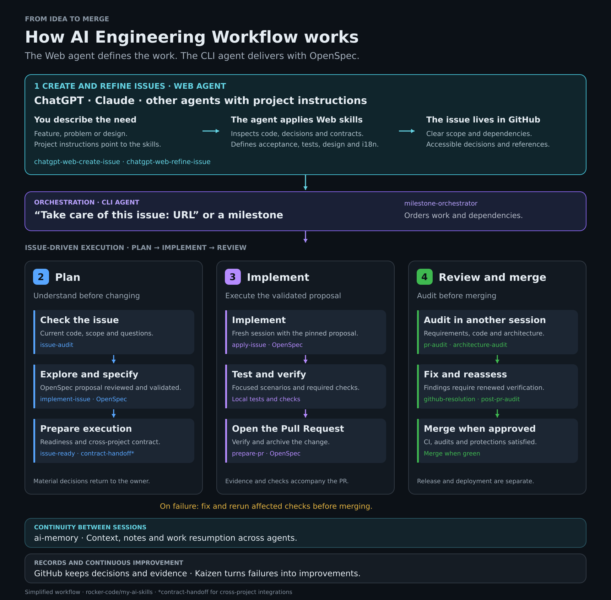

The diagram above uses the editable SVG source directly. To export a PNG, run `inkscape docs/images/fluxo-my-ai-skills.en.svg --export-type=png --export-filename=docs/images/fluxo-my-ai-skills.en.png`.

### The workflow at a glance

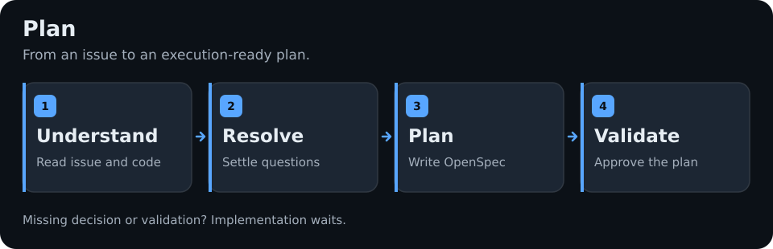

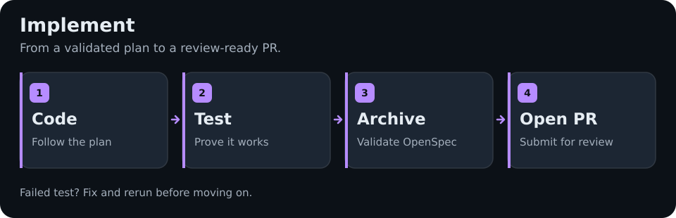

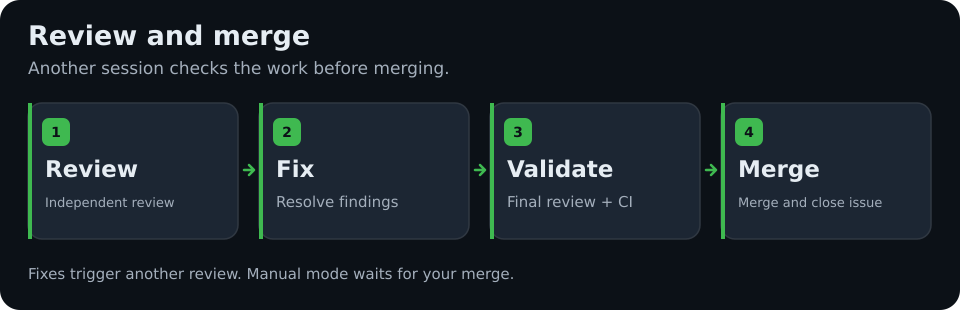

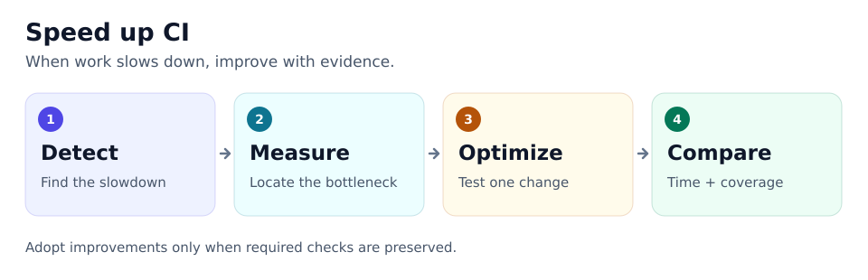

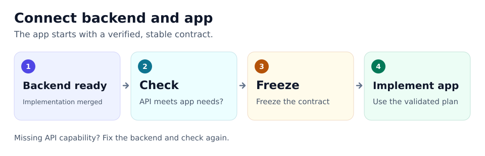

<details>
<summary>Technical details, skills and rules for each stage</summary>

### Technical flow reference

Read each diagram from top to bottom. Boxes describe what happens; diamonds show a decision. Skill names are listed below each flow so the sequence can be understood without knowing the installed commands. These views summarize the existing workflow; validation, independent sessions and repository gates still apply.

#### 1. From an issue to delivery

Start with one issue, a repository queue or a milestone. The orchestrator uses the same delivery cycle for each eligible issue.

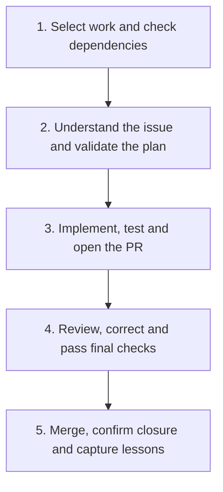

| Part of the flow | Skills responsible |
|---|---|
| Coordinate the selected scope and dependencies | `milestone-orchestrator` |
| Check the issue and validate its plan | `issue-audit`, `implement-issue` |
| Implement and prepare the PR | `apply-issue`, `prepare-pr` |
| Review and resolve findings | `pr-audit`, `github-resolution`, `post-pr-audit` |
| Capture evidenced improvements after merge | `kaizen` |

Independent issues can run concurrently in isolated sessions/worktrees. Hard dependencies wait for confirmed merges. With **"no merge"**, the cycle stops at **READY_TO_MERGE** after review and required checks. Release and deployment require a separate request.

#### 2. Planning: understand before implementing

The planning agent checks the issue against current code, resolves missing information and validates an exact OpenSpec proposal revision. It continues automatically when the evidence is sufficient.

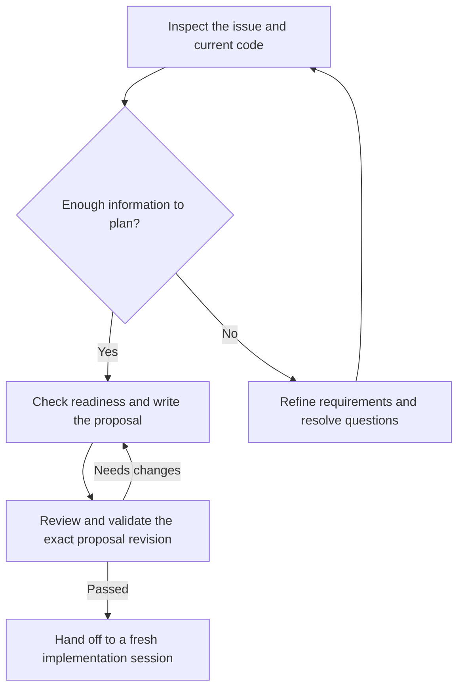

| Responsibility | Skills |
|---|---|
| Coordinate planning | `implement-issue` |
| Verify claims and explore current behavior | `issue-audit`, `issue-explore` |
| Refine requirements or resolve material questions | `refine-issue`, `resolve-questions` |
| Enforce readiness and the OpenSpec proposal gate | `issue-ready`, `openspec-workflow` |
| Check domain rules when applicable | `magento-review`, `expo-mobile-review` |

After material decisions, exploration repeats before readiness. Routine questions are resolved from evidence; unresolved material product or architecture decisions require owner input and block only affected work. Failed validation keeps the issue in planning.

#### 3. Implementation: turn the validated plan into a PR

Implementation starts in a fresh session against the pinned, validated proposal. Tests prove the acceptance criteria and concrete risks; applicable repository checks remain required.

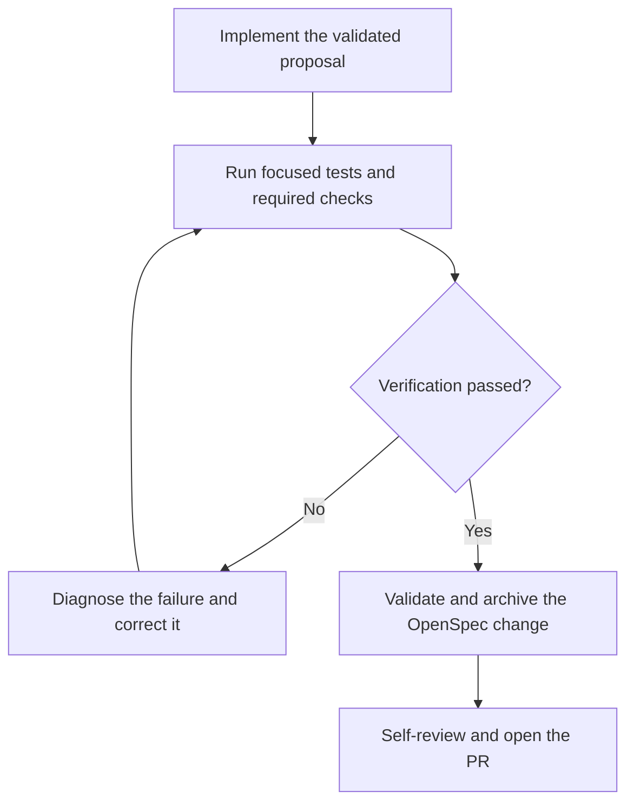

| Responsibility | Skills |
|---|---|
| Implement and verify in a fresh session | `apply-issue` |
| Enforce verification, strict validation and archive | `openspec-workflow` |
| Perform applicable quality analysis | `sonar` |
| Prepare the commit and PR with evidence | `prepare-pr` |

For integration-heavy changes, check the environment and fixtures before an expensive run, prove a narrow scenario first, then run the full required local suite against the commit candidate. Archive only after verification and strict validation pass; include the archive and synchronized specs in the same PR. If new evidence changes the validated contract, return to planning before continuing implementation.

#### 4. Review: correct findings before merge

A standalone review reports findings. Corrections and merge happen only in an authorized resolution run.

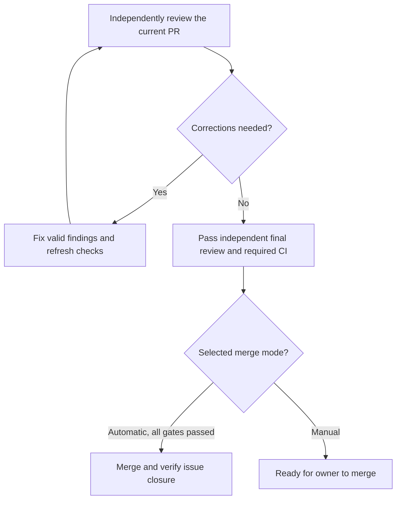

| Responsibility | Skills |
|---|---|
| Independently review requirements, code and tests | `pr-audit` |
| Check changed boundaries and coupling when applicable | `architecture-audit` |
| Coordinate authorized corrections and refreshed audits | `github-resolution` |
| Fix valid review findings | `address-pr-review` |
| Perform the independent final gate and authorized merge | `post-pr-audit` |
| Capture lessons after confirmed merge and closure | `kaizen` |

A failed final review or CI check keeps the PR in review/correction. A new push requires affected evidence to be refreshed against the current head. Automatic merge never bypasses required checks, reviews or branch protections.

#### 5. CI performance: support inside the existing steps

Performance work is routed automatically when an issue or diff triggers the performance rules. It supports planning, implementation and review within the delivery cycle.

| When it is needed | What happens | Skills |
|---|---|---|
| An issue reports a slow pipeline | Diagnose measured bottlenecks before proposing a change | `issue-audit` → `ci-performance-audit` |
| Planning or implementing a performance change | Plan a bounded experiment, then compare results | `implement-issue` / `apply-issue` → `optimize-ci` |
| Preparing or reviewing relevant CI/test changes | Check performance evidence and preserved test obligations | `prepare-pr` / `pr-audit` → `ci-performance-audit` |
| Repeated slowdown is evidenced after delivery | Investigate whether a focused process improvement is justified | `kaizen` → `ci-performance-audit` |

Ordinary test additions receive a lightweight check. `post-pr-audit` consumes current-head evidence; it does not automatically launch another benchmark.

#### 6. Backend to mobile: agree on the contract first

The consumer's requirements are checked during planning. After the producer implementation is merged, the final handoff verifies the implemented contract before consumer implementation starts.

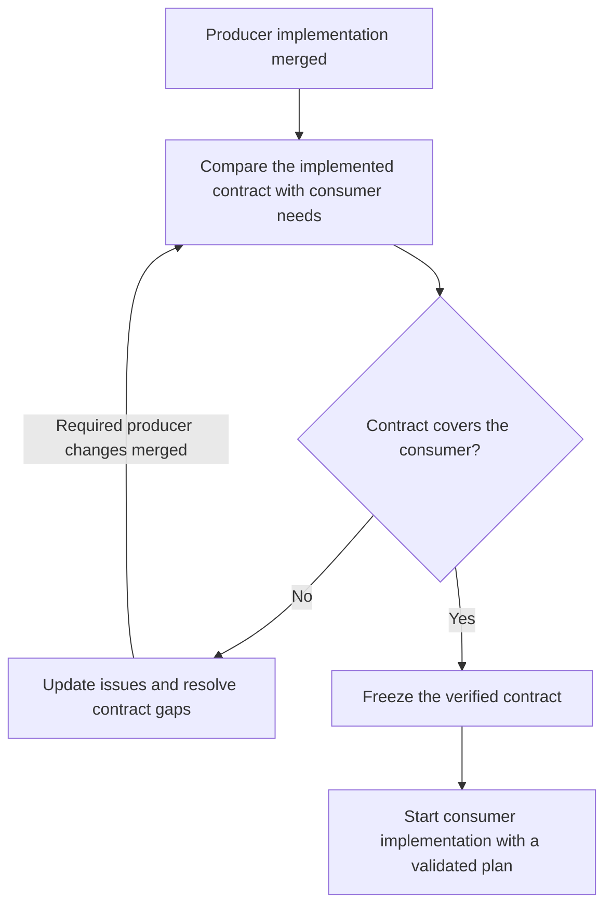

| Responsibility | Skills |
|---|---|
| Verify scenarios against the producer and freeze the final contract | `contract-handoff` |
| Update incomplete producer or consumer requirements | `refine-issue` |
| Plan and validate consumer work | `implement-issue` |
| Implement only after the final freeze and proposal gate | `apply-issue` |

Missing producer capabilities become hard dependencies. If only the consumer issue needs clarification, update it and repeat the comparison; no producer change is needed. A contract change after the freeze requires a revised consumer issue and another handoff.

</details>

`pr-status` is a read-only status utility. `update-main` and `release` are available for explicitly requested maintenance/release work; the milestone flow does not automatically release or deploy.

Invoking `/prepare-pr` authorizes the skill to stage and commit only files for the current issue, push its feature branch without force, and open the PR. It does not authorize merging. Explicitly requesting a prepare-only run keeps the work local.

After implementation and tests pass, archive the completed OpenSpec change on the feature branch before `/prepare-pr`. The archive and synchronized live specs belong in the same issue PR, avoiding a follow-up archive-only PR. During PR audits, review the validated change under `openspec/changes/archive/` together with live specs.

Start with **"Take care of this issue: URL"** for one issue, **"Take care of this issue: URL, no merge"** to keep its merge manual, **"Take care of this project queue"** for the current repository, **"Take care of this project queue, no merges"** to opt out of merging, or **"Take care of this milestone: URL"** to limit the scope. `milestone-orchestrator` runs once for the selected scope. For one issue, it inventories that issue and its verified linked PR; for a queue or milestone, it inventories all selected issues. It builds a dependency DAG, and schedules independent work in isolated child sessions/worktrees while serializing hard dependencies and likely file conflicts. It reviews each eligible OpenSpec proposal against the issue and current code, validates its exact SHA without a routine owner approval checkpoint, then automatically runs fresh Apply sessions, tests, verification, archive, PR preparation, github-resolution, independent audits and CI. The default is merge when green for the selected run, only after all required checks, reviews and branch protections pass; "do not merge" or `merge_mode=manual` overrides it. Blocked issues do not stop unrelated work. If the runtime lacks child-session/worktree capability, it reports the missing capability instead of claiming end-to-end automation.

Production implementation does not begin while blocking questions remain or before the OpenSpec readiness gate passes. A second exploration after decisions is mandatory for material changes.

## Skills

### Shared workflow

| Skill | Responsibility |
|---|---|
| `milestone-orchestrator` | Run one selected issue, the current repository queue or a selected milestone; review and validate pinned OpenSpec proposals, schedule isolated workers and merge eligible PRs when green by default. |
| `issue-explore` | Add the supervised GitHub question/output protocol to OpenSpec's official CLI command `/opsx-explore`; it is not a replacement CLI command. |
| `issue-ready` | Re-read decisions and enforce the Definition of Ready. |
| `issue-audit` | Verify the issue's claims against current code before exploration. |
| `implement-issue` | Audit, explore, propose and validate the exact OpenSpec revision; hand off automatically unless a material decision is unresolved. |
| `apply-issue` | Implement the pinned validated OpenSpec revision in a new session. |
| `openspec-workflow` | Enforce official OpenSpec commands, exact-revision review and validation, verification, strict validation and archive. |
| `prepare-pr` | Self-review, validate and create/prepare a traceable PR. |
| `pr-audit` | Independently verify PR claims, trust boundary, requirements, OpenSpec, code and tests; publish review findings when authorized. |
| `architecture-audit` | Check boundaries and new coupling without requiring LikeC4. |
| `github-resolution` | Execute audited issues/PRs, correct valid findings and pass each PR to independent final audit and authorized merge. |
| `post-pr-audit` | Independent final review and merge gate; merge when green by default, unless the direct request opts out. |
| `update-main` | Safely fast-forward the local `main` after merge, preserving uncommitted work. |
| `release` | Publish a verified version from the repository's documented changelog and versioning policy, only after CI is green on the exact release commit. |
| `kaizen` | Convert evidenced failures into focused project or process improvements. |
| `address-pr-review` | Refresh feedback, fix valid review findings and reply with evidence. |
| `pr-status` | Read-only classification of the current PR state and next action. |
| `contract-handoff` | Trace consumer scenarios to producer contracts during planning, record hard dependencies for gaps, then freeze the final implemented contract before consumer work. |
| `visual-artifact-implementation` | Apply approved visual exports attached to issues using native UI components and visual-verification evidence, without a separate workflow. |

### Web supervision

The two `chatgpt-web-*` skills provide portable Markdown instructions for **ChatGPT, Claude and other Web agents with project instructions**. The existing names are kept for compatibility. Read access to the instructions/repositories is required; issue writes require an authorized GitHub connector or equivalent integration. These instructions do not automatically install native capabilities and do not replace CLI execution. See the [Web issue protocol](protocol/CHATGPT_WEB_ISSUES.md).


| Skill | Responsibility |
|---|---|
| `refine-issue` | Convert an idea or draft issue into an implementable specification. |
| `resolve-questions` | Analyze `[QUESTION]` comments and record evidence-backed `[DECISION]` responses. |
| `chatgpt-web-create-issue` | Web supervision: research context and create detailed, linked, implementation-ready GitHub issues. |
| `chatgpt-web-refine-issue` | Web supervision: discuss and resolve questions, refine existing issues and register durable decisions. |

### Configure the Web agent project

To use both skills in project conversations, make a GitHub connector or equivalent authorized integration available with access to `rocker-code/my-ai-skills` and the target repositories. Copy the block below into the **Web agent's project instructions** (ChatGPT, Claude or equivalent). It directs the agent to current GitHub instructions; it does not automatically install skills or change account settings.

You do not need to attach skill files to every conversation when the connector can read them. Detailed rules live in versioned protocols: updates become available after merging into `main`. Update the project configuration if this routing text itself changes. If source access fails, the agent must report which files it could not read instead of claiming to have applied the latest version.

The same text can be used in ChatGPT, Claude or another agent that accepts persistent project descriptions. Capabilities depend on the environment: reading instructions does not grant GitHub access or permission to create issues. Without a write integration, the agent may prepare a draft while stating that it was not published.

#### Instructions to copy

```text
# Rocker Code — Project Instructions

This project uses https://github.com/rocker-code/my-ai-skills as its reference
for software engineering and GitHub issue management.

## Web agent skills (ChatGPT, Claude or equivalent)

Use these instructions in ChatGPT, Claude or another agent with project instructions.
The chatgpt-web-* names are retained for compatibility. Source read access is required;
issue mutations require an authorized GitHub integration.

At the start of each issue creation or review task, use the available GitHub
integration to read the current main version of the relevant skill and shared protocol:

- Creation: skills/chatgpt-web-create-issue/SKILL.md
- Review/refinement: skills/chatgpt-web-refine-issue/SKILL.md
- Protocol: protocol/CHATGPT_WEB_ISSUES.md
- Visual design, when applicable: protocol/VISUAL_ARTIFACTS.md

Also read the necessary references linked by these files. Reuse the reads within
the same task; refresh them after relevant changes. If a source is inaccessible,
report the limitation and do not invent its contents.

## Rules

- Apply the appropriate skill without requiring special commands.
- Inspect issues, comments, decisions, PRs and relevant code; identify the inspected
  revision and existing implementation to avoid duplicate work.
- Preserve Magento, Mobile and Operational App conventions. Distinguish verified
  facts, approved decisions, proposals and open questions.
- Start each issue with a plain summary: what changes, where and what it depends on.
  Define expected behavior, scope, non-goals and observable acceptance criteria.
- Include test scenarios in a table with setup/action, expected result and suggested
  proving layer. Focus on real risks, reuse tests and fixtures and avoid exhaustive
  matrices or duplicate coverage.
- For integrations, document current and expected signatures, examples, states,
  errors, authorization and producer/consumer dependencies. Mark proposed contracts
  as unimplemented/unfrozen; record the effective signature after the handoff
  before final integration.
- For backend, integration or architecture changes, include a simple Mermaid system
  design with verifiable responsibilities and data flow.
- For interfaces, include a character wireframe in a text block, key states/actions
  and accessible, versioned, approved visual references when a design exists.
  Illustrative values are not real data. Follow VISUAL_ARTIFACTS.md; a private
  Claude Artifacts link alone does not prove design access.
- For user-facing content, include i18n and translation using the project's existing
  mechanism and locale: copy, states, errors, accessibility, dates, numbers, currency
  and plurals. Define who localizes API text; do not expose raw enums or keys.
  Preserve domain names/data and provide safe translated fallbacks for unknown
  codes, with representative acceptance criteria and tests.
- Keep behavior, design, wireframes, contract, criteria and tests consistent.
  Narrow changes must preserve unrelated content and decisions.
- Explain technical questions and alternatives simply when a material user decision
  is pending. Resolve routine details through evidence and do not request extra
  confirmation for actions already requested or authorized.
- Record approved decisions in issues when requested. Verify GitHub mutations before
  claiming success and provide links and remaining blockers.
- Do not implement code while authoring/refining issues; execution follows the CLI
  workflow with OpenSpec. Do not invent inspected code, contracts, attachments
  or executed tests.

## Working style

Accept natural requests such as:
- "Create an issue for..."
- "Analyze issue #123."
- "Answer the question in this issue."
- "Review the milestone's issues."
- "Update the specification using the attached design."

Do not require the user to repeat these instructions.
```

#### Expected issue standard

| Situation | Expected content |
|---|---|
| Every issue | Summary, expected behavior, boundaries, acceptance criteria and proportionate test scenarios. |
| Existing implementation | Current state with evidence/revision, code and tests to reuse or update. |
| API or integration | Current → expected contract, examples, states/errors, ownership and delivery order. |
| Backend, integration or architecture | Mermaid system design that is readable at a glance. |
| Interface | Character wireframe and approved/versioned reference when available, with relevant states/actions. |
| User-facing content | i18n/translation section, app/API ownership, local formatting and representative validation. |

Sections are conditional and follow the [shared protocol](protocol/CHATGPT_WEB_ISSUES.md). The Web agent prepares and refines the backlog; the CLI agent remains responsible for exploration, OpenSpec validation, implementation, tests and PRs. Configuring the block above is a user action; a PR in this repository does not update existing project instructions in ChatGPT, Claude or another Web agent.

### Domain checks

| Skill | Responsibility |
|---|---|
| `magento-review` | Adobe Commerce/Magento architecture and implementation checklist, including native reuse and concurrency. |
| `expo-mobile-review` | Expo/React Native navigation, state, GraphQL, resilience, accessibility and E2E checklist. |
| `sonar` | Agent-agnostic SonarQube CLI quality/security analysis, secret scanning, finding classification and remediation evidence. |

### Implementing approved UI designs

Attach the approved, versioned Claude Artifact export (ZIP or accessible project files) and preview screenshots to the GitHub issue; include the original Artifact link as optional context, target screens, and behavior that must remain unchanged. Then use the normal command **"Take care of this issue: URL"**. `issue-audit` and `apply-issue` automatically use [the visual artifact protocol](protocol/VISUAL_ARTIFACTS.md), OpenSpec planning, native UI components and representative verification. Inaccessible private links and missing visual tooling must be disclosed rather than guessed.

## GitHub protocol

Discussion markers:

```text
[QUESTION]
[DECISION]
[IMPLEMENTATION NOTE]
[RESOLVED]
```

Review severities:

```text
[BLOCKER]
[MUST FIX]
[SHOULD FIX]
[NICE TO HAVE]
```

Test coverage follows [TEST_STRATEGY.md](protocol/TEST_STRATEGY.md) automatically in planning, implementation and review. Agents select representative scenarios from acceptance criteria and concrete risks, reuse fixtures, and avoid duplicating the full rule matrix across unit, integrated and GraphQL tests. Reviewers must justify extra tests by the failure existing evidence would miss. Required checks remain mandatory; repeated failures trigger diagnosis rather than blind retries. No new skill installation or approval step is needed. Existing tests for the affected behavior are also checked for redundancy or obsolete expectations. Broader suite simplification runs as a dedicated, measured task with proof preserved for every consolidated, migrated or removed test.

Read [AI_WORKFLOW.md](protocol/AI_WORKFLOW.md), [GITHUB_CONVENTIONS.md](protocol/GITHUB_CONVENTIONS.md) [REVIEW_POLICY.md](protocol/REVIEW_POLICY.md) and [CI_PERFORMANCE.md](protocol/CI_PERFORMANCE.md) for the canonical rules.

## Helper scripts

The context scripts require `gh` and `jq`; the timing scripts require Python 3.10+ and GitHub CLI access. `workflow-event` updates one hidden structured comment per issue/run; `workflow-report` is read-only:

```bash
scripts/issue-context https://github.com/owner/repo/issues/123
scripts/pr-context https://github.com/owner/repo/pull/124
scripts/workflow-status https://github.com/owner/repo/issues/123
scripts/workflow-event new-run-id
scripts/workflow-report https://github.com/owner/repo/issues/123
```

### Workflow timing metrics

The orchestrator creates a shared run ID, then uses `workflow-event` at real gate boundaries. A single hidden, structured GitHub issue comment is maintained per issue/run; each event updates that comment instead of adding a comment per transition. For a milestone, initialize every issue in the selected scope with the same run ID, including blocked or queued issues. Record stage start/end and explicit wait start/end events. Rework is recorded only when a completed gate must be revisited because of a review finding, failed check, replan or reopening.

```bash
RUN_ID=$(scripts/workflow-event new-run-id)
scripts/workflow-event run-start --issue https://github.com/owner/repo/issues/123 \
  --run-id "$RUN_ID" --scope single_issue --agent codex
scripts/workflow-event stage-start --issue https://github.com/owner/repo/issues/123 \
  --run-id "$RUN_ID" --stage issue_audit --worker-id orchestrator --agent codex
scripts/workflow-event stage-end --issue https://github.com/owner/repo/issues/123 \
  --run-id "$RUN_ID" --stage issue_audit --worker-id orchestrator --status completed
scripts/workflow-event run-end --issue https://github.com/owner/repo/issues/123 \
  --run-id "$RUN_ID" --status completed

scripts/workflow-report https://github.com/owner/repo/issues/123
scripts/workflow-report https://github.com/owner/repo/milestone/7 --run-id "$RUN_ID"
scripts/workflow-report https://github.com/owner/repo/milestone/7 --format json
scripts/workflow-report https://github.com/owner/repo/milestone/7 --format csv
```

For wait events, pass a stage and one reason: `owner_input`, `dependency`, `ci`, `review`, `runtime_capacity`, `external` or `other`. For rework, use `--reason review|ci|replan|reopened|other` and link evidence with `--evidence` (a GitHub URL or commit SHA). Optional agent/model values are recorded only when the runtime exposes them. Do not include prompts or sensitive text.

The report shows issue cycle time, recorded work, explicit waits, stages, rework, PR review findings and failed/pending checks. A milestone report includes state counts and per-stage medians; it shows P90 only when there are at least five samples. Use `--run-id` to get a common milestone execution. The total registered work can exceed calendar time when workers ran in parallel. Recorded work is wall-clock time within stage windows minus explicitly marked waits, not model-internal thinking time. Missing data is reported as unavailable, never inferred from issue labels or conversation text.

Timing metrics support `kaizen`: after completion, compare recurring bottlenecks with rework and quality evidence before suggesting a process change. A single slow run does not justify changing a gate. Tokens and cost are not estimated when the runtime does not expose them.


The context helpers normalize live GitHub context so agents refresh comments, decisions, reviews and CI instead of relying on stale chat context.

## Step-by-step installation

Use the terminal in the application repository you want the agents to work on. The examples use Bash (Linux, macOS or Git Bash) and OpenCode; replace `opencode` with `codex` or `claude-code` for your agent.

### 1. Check prerequisites and GitHub access

Install Git, Node.js/npm compatible with the current [OpenSpec requirements](https://github.com/Fission-AI/OpenSpec), GitHub CLI, jq, Python 3.10+ and your chosen agent. Then check:

```bash
git --version
node --version
npm --version
gh --version
jq --version
gh auth status
```

If GitHub CLI is not authenticated, run `gh auth login` in this environment. Access to private repositories must be available to both the installer and the execution agent. The helpers use GitHub CLI authentication; web agents need their own GitHub connection.

### 2. Install the skills for your agent

From the application repository root:

```bash
cd /path/to/your-project
npx skills add rocker-code/my-ai-skills --skill '*' -a opencode -y
```

This installs all skills for the selected agent at project scope. For a personal installation shared across projects, use:

```bash
npx skills add rocker-code/my-ai-skills --skill '*' -a opencode -g -y
```

Choose one scope deliberately. For multiple agents, pass `-a opencode -a codex -a claude-code`. Use `--skill '*'` to select all skills for these agents; `--all` selects all skills **and all agents**. See the [skills CLI documentation](https://github.com/vercel-labs/skills).

For a partial installation, use repeated `--skill <name>` options. Install the skills called by your selected flow as well as its entry skill; installing only `milestone-orchestrator` does not install all its workers automatically.

### 3. Initialize OpenSpec in the application repository

The skills enforce OpenSpec but do not install its CLI or initialize the project:

```bash
npm install -g @fission-ai/openspec@latest
openspec --version
openspec init
```

Select your execution agent in the initializer. If the project is already initialized, inspect its existing configuration and use `openspec update` to refresh the generated integrations instead of recreating the setup. Preserve repository instructions and project-specific configuration.

Use the commands generated for your agent: their syntax can differ between agents and OpenSpec versions. This repository's `openspec-workflow` verifies the official commands available in the installed version. See the [OpenSpec getting-started guide](https://github.com/Fission-AI/OpenSpec/blob/main/docs/getting-started.md).

### 4. Obtain the complementary files

The skills installer copies skill directories and their bundled references. It does **not** copy the repository-root `protocol/`, `templates/` or `scripts/` into your application.

Clone the source once into a separate location. Keep your terminal in the application repository:

```bash
MY_AI_SKILLS_SOURCE="$HOME/.local/share/my-ai-skills"
mkdir -p "$(dirname "$MY_AI_SKILLS_SOURCE")"
gh repo clone rocker-code/my-ai-skills "$MY_AI_SKILLS_SOURCE"
```

If you already have a clone, set `MY_AI_SKILLS_SOURCE` to its absolute path and skip the clone command.

### 5. Copy protocols, templates and runtime helpers into the project

This guide uses `.ai-workflow/` for project-visible copies. It is a documented installation convention, not a path automatically created by the skills installer.

```bash
mkdir -p .ai-workflow/protocol .ai-workflow/templates .ai-workflow/scripts
cp "$MY_AI_SKILLS_SOURCE"/protocol/*.md .ai-workflow/protocol/
cp -R "$MY_AI_SKILLS_SOURCE"/templates/. .ai-workflow/templates/
cp "$MY_AI_SKILLS_SOURCE"/scripts/issue-context .ai-workflow/scripts/
cp "$MY_AI_SKILLS_SOURCE"/scripts/pr-context .ai-workflow/scripts/
cp "$MY_AI_SKILLS_SOURCE"/scripts/workflow-status .ai-workflow/scripts/
cp "$MY_AI_SKILLS_SOURCE"/scripts/workflow-event .ai-workflow/scripts/
cp "$MY_AI_SKILLS_SOURCE"/scripts/workflow-report .ai-workflow/scripts/
cp "$MY_AI_SKILLS_SOURCE"/scripts/workflow_metrics.py .ai-workflow/scripts/
chmod +x .ai-workflow/scripts/issue-context \
  .ai-workflow/scripts/pr-context \
  .ai-workflow/scripts/workflow-status \
  .ai-workflow/scripts/workflow-event \
  .ai-workflow/scripts/workflow-report
```

| Installed files | Purpose |
|---|---|
| `protocol/AI_WORKFLOW.md` | Lifecycle, readiness and implementation gates. |
| `protocol/GITHUB_CONVENTIONS.md` | Durable issue, decision and PR conventions. |
| `protocol/REVIEW_POLICY.md` | Review severity and evidence rules. |
| `protocol/CI_PERFORMANCE.md` | Measured optimization and preserved CI obligations. |
| `protocol/TEST_STRATEGY.md` | Risk-based coverage, proving layers, diagnosis and stopping criteria. |
| `templates/pull-request.md`, `templates/github/*.md` | PR, question, decision, review and integration-contract formats. |
| `scripts/issue-context`, `scripts/pr-context`, `scripts/workflow-status` | Read-only live GitHub context helpers, requiring `gh` and `jq`. |
| `scripts/workflow-event`, `scripts/workflow-report`, `scripts/workflow_metrics.py` | Optional workflow timing capture and issue/milestone reports; require `gh` and Python 3.10+. |

`scripts/sync-plugin` is a package-maintenance tool for this repository. Do not install it as an application runtime helper.

The bundled skill references already contain the applicable protocols/templates. These project copies make the shared rules and helpers accessible to the team; copying them alone does not register skills with an agent.

### 6. Connect the project instructions to the installed files

Append the following guidance to the existing `AGENTS.md` (or the instruction file your agent actually reads), adapting it to project policy. Preserve existing instructions; do not replace the file:

```markdown
## AI development workflow

Use the installed my-ai-skills workflow for issue-driven work.
Read .ai-workflow/protocol/AI_WORKFLOW.md,
.ai-workflow/protocol/GITHUB_CONVENTIONS.md and
.ai-workflow/protocol/REVIEW_POLICY.md and
.ai-workflow/protocol/TEST_STRATEGY.md before executing that workflow.
For CI or test-performance work, also read
.ai-workflow/protocol/CI_PERFORMANCE.md.

Use .ai-workflow/templates/ for the shared output formats.
Refresh live GitHub evidence with .ai-workflow/scripts/issue-context,
.ai-workflow/scripts/pr-context and .ai-workflow/scripts/workflow-status.
Keep project-specific constraints and the user's selected scope and merge mode.
```

For Claude Code, place the guidance in `CLAUDE.md` or reference your shared instruction file from it. Commit the project instructions, protocols, templates and helpers if the installation is intended for the team.

### 7. Verify and start the existing flow

```bash
npx skills list
test -f .ai-workflow/protocol/CI_PERFORMANCE.md
test -f .ai-workflow/protocol/TEST_STRATEGY.md
test -x .ai-workflow/scripts/issue-context
test -x .ai-workflow/scripts/pr-context
test -x .ai-workflow/scripts/workflow-status
test -x .ai-workflow/scripts/workflow-event
test -x .ai-workflow/scripts/workflow-report
test -f .ai-workflow/scripts/workflow_metrics.py
python3 --version
.ai-workflow/scripts/issue-context https://github.com/owner/repo/issues/123
```

Replace the example URL with an issue you can access. For global skills, also check `npx skills list -g`. Restart the agent or start a new session so it discovers the installed skills.

Start with **"Take care of this issue: URL"**, **"Take care of this project queue"** or **"Take care of this milestone: URL"**. The entry workflow routes the supporting skills automatically under their documented conditions; you do not need to invoke each diagram node. Loading skills does not create a background scheduler: a selected workflow still needs to be started, and its runtime must support the required tools and isolated sessions.

### 8. Keep the installation current

Refresh the complementary source clone:

```bash
git -C "$MY_AI_SKILLS_SOURCE" pull --ff-only
```

Then repeat step 2 for the chosen agent/scope and step 5 for the copied files. Review the diff before committing updates: copying overwrites those managed copies, so keep project-specific additions in separate files. Review protocol changes and their bundled skill references together. In a new terminal, set `MY_AI_SKILLS_SOURCE` again to your existing clone path.

## Install as a personal ChatGPT/Codex plugin

The repository also contains a self-contained skills-only plugin at `plugins/my-ai-skills` and a repository marketplace at `.agents/plugins/marketplace.json`.

Add the marketplace once:

```bash
codex plugin marketplace add rocker-code/my-ai-skills --ref main
```

Install the plugin:

```bash
codex plugin add my-ai-skills@rocker-code-ai
```

In the ChatGPT desktop app, restart the app, open the Plugins Directory, select the **Rocker Code AI** marketplace, and install **Rocker Code AI Workflow**. Start a new conversation after installation so the skills are loaded.

The plugin is personal and does not need to be submitted to the public directory. Publishing it to a ChatGPT workspace is a separate administrative action.

The root `skills/`, `protocol/`, `templates/`, and helper scripts remain the canonical source used by `skills.sh`. Their copies inside `plugins/my-ai-skills/` form the self-contained plugin package. Skills that link to shared protocol or templates carry a generated copy in their own `references/` directory, because `skills.sh` installs only each skill directory. After changing canonical files, regenerate those copies and synchronize the package with:

```bash
scripts/sync-plugin
```

## Taking care of one issue

Use either request:

```text
Take care of this issue: https://github.com/owner/repo/issues/123
Take care of this issue: https://github.com/owner/repo/issues/123, no merge
```

The same `milestone-orchestrator` handles this entry point with `scope=single_issue`; no new skill name or manual sequence is needed. It audits, plans/validates OpenSpec, implements in a fresh session, verifies/archives, prepares the PR, independently reviews, fixes findings and reaches merge/closure/kaizen when all gates pass. The second request stops at `READY_TO_MERGE`.

An existing plan or linked implementation PR is resumed from current evidence. Related issues are inspected for dependencies but are not executed automatically. An unmerged hard dependency, missing material decision or runtime capability is reported as a blocker. A closed issue is inspected and reported without reopening it. The automatic CI-performance routing applies here too.

## Milestone operating rules

- Invoke with the current repository queue or an identifiable milestone. The first output is a dependency inventory and the next unblocked work, including evidence for the proposed order.
- Status is reconstructed from issue decisions, committed OpenSpec revision, PR head, reviews and CI. A helper's inferred status or ai-memory summary cannot prove proposal validation or a product decision.
- Schedule independent work by dependency and conflict risk, with isolated sessions/worktrees; queue hard dependents until prerequisites merge. Resolve dependency cycles and unclear links before work on affected issues.
- The agent reviews and validates the pinned proposal SHA; owner input is reserved for unresolved material decisions. Merge when green is the default for the selected run after final review and required gates; "do not merge" or `merge_mode=manual` opts out. The orchestrator does not release or deploy.
- If a new implementation session is unavailable, keep the committed plan and return a copyable handoff. A failed or interrupted run resumes at its last verified gate.
- A merged PR and closed issue are verified before kaizen. ghpending is optional for daily triage; GitHub Project is a product planning view.

## Recommended cross-repository flow

For backend → mobile work:

1. merge backend contract issues;
2. run `contract-handoff` against the final backend code and the mobile issue;
3. update the consumer issue if necessary;
4. declare `CONTRACT FROZEN`;
5. only then implement the consumer.

If the producer contract changes after the freeze, explicitly revise the consumer issue and repeat the handoff.
## Automatic CI performance improvement

The existing queue and milestone commands automatically route relevant work to two domain skills:

| Skill | Responsibility |
|---|---|
| `ci-performance-audit` | Diagnose measured bottlenecks and independently review optimization evidence and preserved CI obligations. |
| `optimize-ci` | Guide bounded experiments through the existing OpenSpec planning, fresh Apply session and review workflow. |

No manual skill invocation is required. Performance issues trigger diagnosis/planning; material workflow, fixture, setup or test-selection changes trigger proportional review; kaizen diagnoses evidenced recurring slowdown. Ordinary test additions receive a lightweight check, not a mandatory hosted benchmark. Scheduling and merge authority remain with the existing orchestrator and review skills.

Read [CI_PERFORMANCE.md](protocol/CI_PERFORMANCE.md). Compare elapsed time, runner-minutes and behavioral proof; a faster green pipeline alone does not prove improvement. Magento-specific guidance is bundled with ci-performance-audit. Source changes are synchronized to the plugin by `scripts/sync-plugin`.
