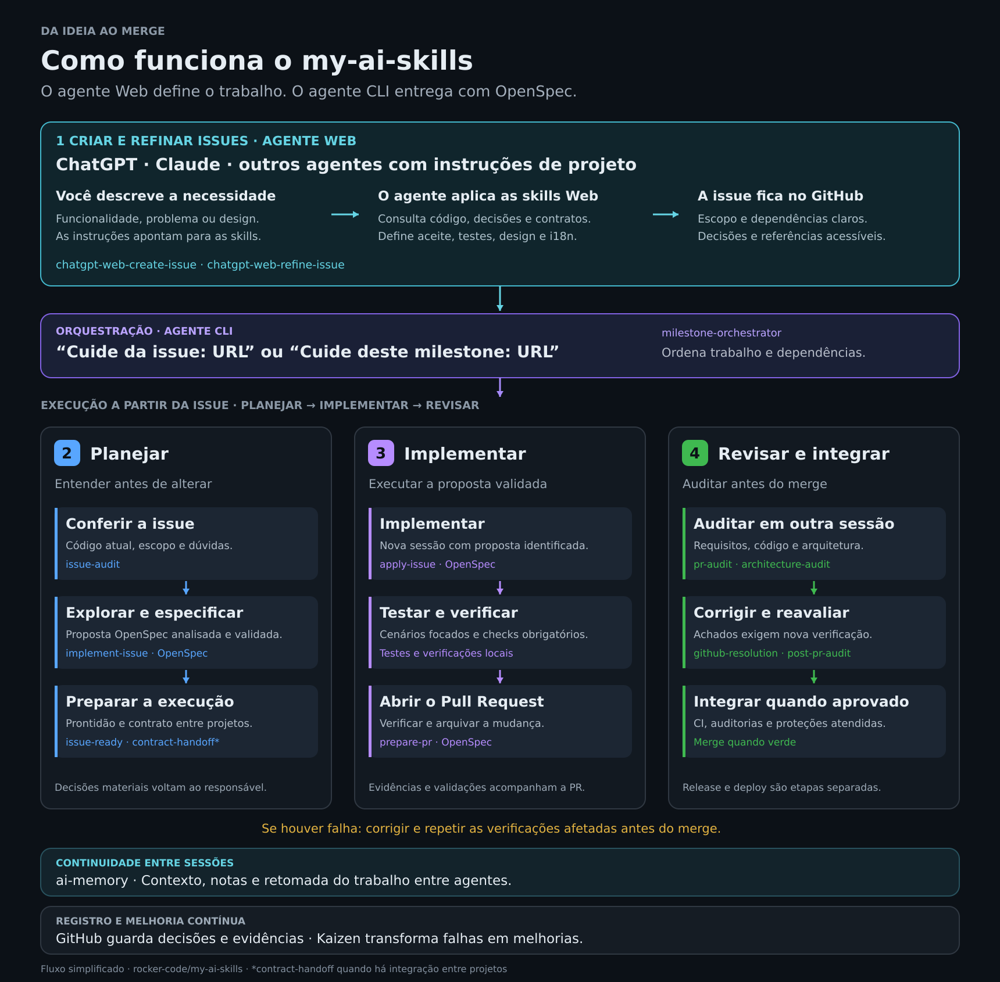
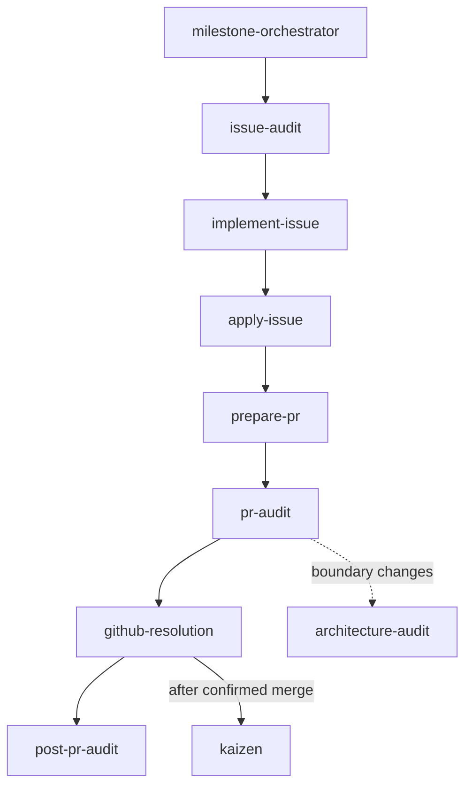
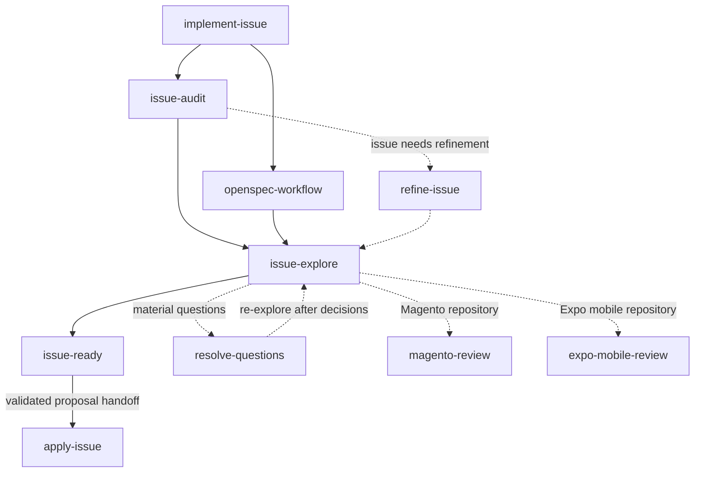
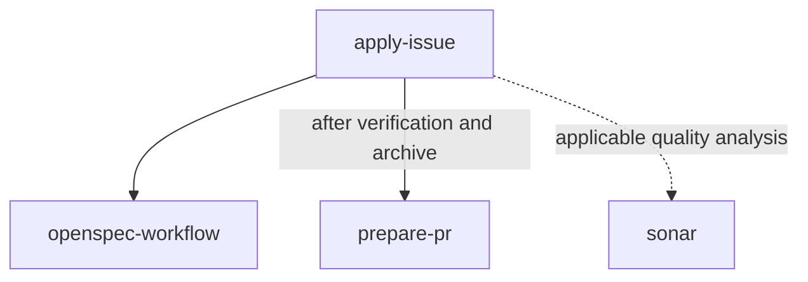
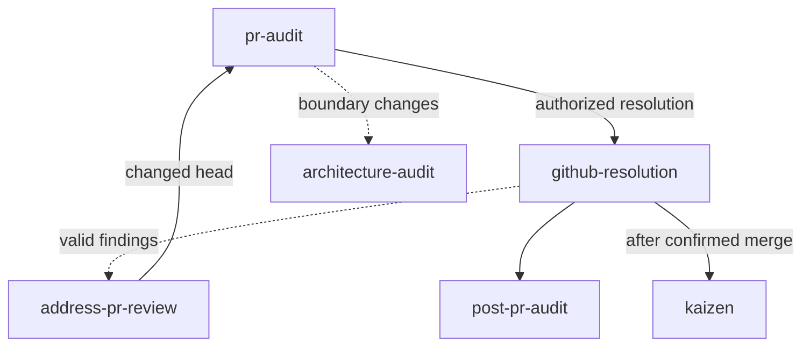
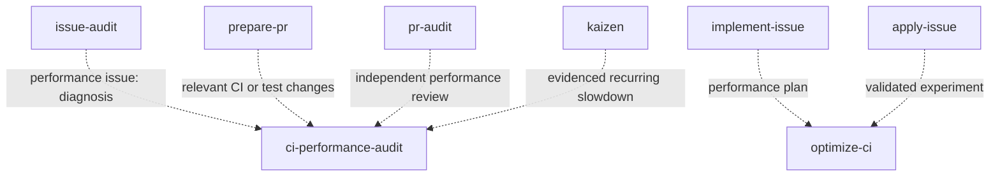
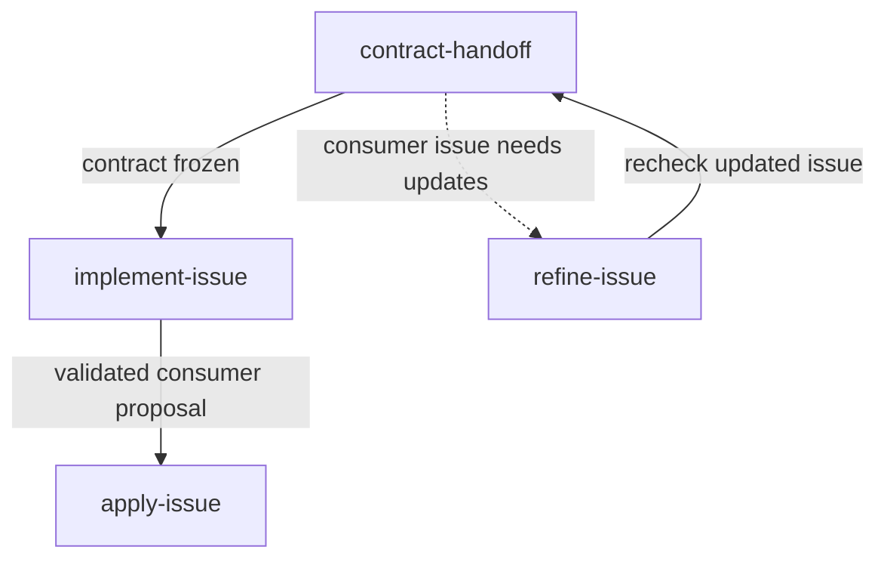

# my-ai-skills

Reusable skills and tools for a supervised, issue-driven AI software development lifecycle using GitHub, OpenSpec, ChatGPT, Codex, Claude and Claude Code.

The repository defines one shared protocol across two operating layers:

- **Web / coordination:** requirements, decisions, architecture, contract handoff and independent review.
- **CLI / execution:** repository exploration, OpenSpec, implementation, tests, PR preparation and review fixes.

GitHub is the source of truth. Material decisions must end up in an issue, PR, architecture document, OpenSpec artifact or code—not only in chat history.

## Lifecycle

The lifecycle moves through discovery, readiness, implementation, review and completion. OpenSpec is required; `openspec-workflow` governs exploration, proposals, exact-revision validation, implementation verification and archive.



### Skills called in each flow

Every diagram node is an installed skill. Solid arrows show the main coordination or handoff; dotted arrows show conditional calls or a supporting skill. An arrow does not bypass validation, authorization or independent-session gates. These are skill maps, not a list of commands to invoke manually.

#### Single issue, queue or milestone coordination

`milestone-orchestrator` schedules the following flow for one selected issue or for each eligible issue in a queue/milestone. The detailed planning and review maps below expand its workers. Independent work can run concurrently; hard dependencies wait for confirmed merges.



#### Issue planning and questions

`implement-issue` coordinates the audit, exploration, readiness and proposal. Refinement and question resolution are used when evidence or material decisions are missing. After material decisions, exploration repeats before readiness. The proposal is reviewed and validated at its pinned revision before the fresh implementation session.



#### Implementation and PR preparation

`apply-issue` runs in a fresh session against the pinned validated proposal. For integration-heavy changes, planning records the proving scenarios and local environment, while Apply checks fixtures and setup before an expensive run, tests a narrow scenario, diagnoses each failure, then runs the repository's full required local suite against the commit candidate. Verification, strict validation, task completion and archive happen before `prepare-pr`. Applicable quality analysis can use `sonar`; it is not an extra mandatory phase for every issue. Repository-specific domain skills are loaded during exploration as shown above.



#### Independent review, corrections and merge

A standalone `pr-audit` reports findings; it does not start fixes or merge on its own. In an authorized resolution run, `github-resolution` coordinates corrections, refreshed audits and the independent final gate. Merge remains subject to current-head checks and the selected merge mode.



#### Automatic CI performance routing

The existing workflow calls these skills automatically when the issue or diff triggers the performance rules. `optimize-ci` works inside planning and implementation; `ci-performance-audit` supplies diagnosis or an independent review lens. Ordinary test additions get a lightweight check. `post-pr-audit` consumes current-head audit evidence; it does not automatically start another benchmark.



#### Cross-repository contract handoff

After the producer's implementation is merged, `contract-handoff` verifies the implemented contract and the consumer issue. Missing consumer requirements go through refinement; consumer planning starts only after the contract is frozen.



`pr-status` is a read-only status utility. `update-main` and `release` are available for explicitly requested maintenance/release work; the milestone flow does not automatically release or deploy.

Invoking `/prepare-pr` authorizes the skill to stage and commit only files for the current issue, push its feature branch without force, and open the PR. It does not authorize merging. Explicitly requesting a prepare-only run keeps the work local.

After implementation and tests pass, archive the completed OpenSpec change on the feature branch before `/prepare-pr`. The archive and synchronized live specs belong in the same issue PR, avoiding a follow-up archive-only PR. During PR audits, review the validated change under `openspec/changes/archive/` together with live specs.

Start with **"Cuide da issue: URL"** for one issue, **"Cuide da issue: URL, sem merge"** to keep its merge manual, **"Cuide da fila deste projeto"** for the current repository, **"Cuide da fila deste projeto, sem merges"** to opt out of merging, or **"Cuide deste milestone: URL"** to limit the scope. `milestone-orchestrator` runs once for the selected scope. For one issue, it inventories that issue and its verified linked PR; for a queue or milestone, it inventories all selected issues. It builds a dependency DAG, and schedules independent work in isolated child sessions/worktrees while serializing hard dependencies and likely file conflicts. It reviews each eligible OpenSpec proposal against the issue and current code, validates its exact SHA without a routine owner approval checkpoint, then automatically runs fresh Apply sessions, tests, verification, archive, PR preparation, github-resolution, independent audits and CI. The default is merge when green for the selected run, only after all required checks, reviews and branch protections pass; "do not merge" or `merge_mode=manual` overrides it. Blocked issues do not stop unrelated work. If the runtime lacks child-session/worktree capability, it reports the missing capability instead of claiming end-to-end automation.

Production implementation does not begin while blocking questions remain or before the OpenSpec readiness gate passes. A second exploration after decisions is mandatory for material changes.

## Skills

### Shared workflow

| Skill | Responsibility |
|---|---|
| `milestone-orchestrator` | Run one selected issue, the current repository queue or a selected milestone; review and validate pinned OpenSpec proposals, schedule isolated workers and merge eligible PRs when green by default. |
| `issue-explore` | Add the supervised GitHub question/output protocol to OpenSpec's official CLI command `/opsx-explore`; it is not a replacement CLI command. |
| `issue-ready` | Re-read decisions and enforce the Definition of Ready. |
| `issue-audit` | Verify the issue's claims against current code before exploration. |
| `implement-issue` | Audit, explore, propose and validate the exact OpenSpec revision; hand off automatically unless a material decision is unresolved. |
| `apply-issue` | Implement the pinned validated OpenSpec revision in a new session. |
| `openspec-workflow` | Enforce official OpenSpec commands, exact-revision review and validation, verification, strict validation and archive. |
| `prepare-pr` | Self-review, validate and create/prepare a traceable PR. |
| `pr-audit` | Independently verify PR claims, trust boundary, requirements, OpenSpec, code and tests; publish review findings when authorized. |
| `architecture-audit` | Check boundaries and new coupling without requiring LikeC4. |
| `github-resolution` | Execute audited issues/PRs, correct valid findings and pass each PR to independent final audit and authorized merge. |
| `post-pr-audit` | Independent final review and merge gate; merge when green by default, unless the direct request opts out. |
| `update-main` | Safely fast-forward the local `main` after merge, preserving uncommitted work. |
| `release` | Publish a verified version from the repository's documented changelog and versioning policy, only after CI is green on the exact release commit. |
| `kaizen` | Convert evidenced failures into focused project or process improvements. |
| `address-pr-review` | Refresh feedback, fix valid review findings and reply with evidence. |
| `pr-status` | Read-only classification of the current PR state and next action. |
| `contract-handoff` | Trace consumer scenarios to producer contracts during planning, record hard dependencies for gaps, then freeze the final implemented contract before consumer work. |
| `visual-artifact-implementation` | Apply approved visual exports attached to issues using native UI components and visual-verification evidence, without a separate workflow. |

### Web supervision

| Skill | Responsibility |
|---|---|
| `refine-issue` | Convert an idea or draft issue into an implementable specification. |
| `resolve-questions` | Analyze `[QUESTION]` comments and record evidence-backed `[DECISION]` responses. |

### Domain checks

| Skill | Responsibility |
|---|---|
| `magento-review` | Adobe Commerce/Magento architecture and implementation checklist, including native reuse and concurrency. |
| `expo-mobile-review` | Expo/React Native navigation, state, GraphQL, resilience, accessibility and E2E checklist. |
| `sonar` | Agent-agnostic SonarQube CLI quality/security analysis, secret scanning, finding classification and remediation evidence. |

### Implementing approved UI designs

Attach the approved, versioned Claude Artifact export (ZIP or accessible project files) and preview screenshots to the GitHub issue; include the original Artifact link as optional context, target screens, and behavior that must remain unchanged. Then use the normal command **"Cuide da issue: URL"**. `issue-audit` and `apply-issue` automatically use [the visual artifact protocol](protocol/VISUAL_ARTIFACTS.md), OpenSpec planning, native UI components and representative verification. Inaccessible private links and missing visual tooling must be disclosed rather than guessed.

## GitHub protocol

Discussion markers:

```text
[QUESTION]
[DECISION]
[IMPLEMENTATION NOTE]
[RESOLVED]
```

Review severities:

```text
[BLOCKER]
[MUST FIX]
[SHOULD FIX]
[NICE TO HAVE]
```

Test coverage follows [TEST_STRATEGY.md](protocol/TEST_STRATEGY.md) automatically in planning, implementation and review. Agents select representative scenarios from acceptance criteria and concrete risks, reuse fixtures, and avoid duplicating the full rule matrix across unit, integrated and GraphQL tests. Reviewers must justify extra tests by the failure existing evidence would miss. Required checks remain mandatory; repeated failures trigger diagnosis rather than blind retries. No new skill installation or approval step is needed. Existing tests for the affected behavior are also checked for redundancy or obsolete expectations. Broader suite simplification runs as a dedicated, measured task with proof preserved for every consolidated, migrated or removed test.

Read [AI_WORKFLOW.md](protocol/AI_WORKFLOW.md), [GITHUB_CONVENTIONS.md](protocol/GITHUB_CONVENTIONS.md) [REVIEW_POLICY.md](protocol/REVIEW_POLICY.md) and [CI_PERFORMANCE.md](protocol/CI_PERFORMANCE.md) for the canonical rules.

## Helper scripts

The context scripts require `gh` and `jq`; the timing scripts require Python 3.10+ and GitHub CLI access. `workflow-event` updates one hidden structured comment per issue/run; `workflow-report` is read-only:

```bash
scripts/issue-context https://github.com/owner/repo/issues/123
scripts/pr-context https://github.com/owner/repo/pull/124
scripts/workflow-status https://github.com/owner/repo/issues/123
scripts/workflow-event new-run-id
scripts/workflow-report https://github.com/owner/repo/issues/123
```

### Workflow timing metrics

The orchestrator creates a shared run ID, then uses `workflow-event` at real gate boundaries. A single hidden, structured GitHub issue comment is maintained per issue/run; each event updates that comment instead of adding a comment per transition. For a milestone, initialize every issue in the selected scope with the same run ID, including blocked or queued issues. Record stage start/end and explicit wait start/end events. Rework is recorded only when a completed gate must be revisited because of a review finding, failed check, replan or reopening.

```bash
RUN_ID=$(scripts/workflow-event new-run-id)
scripts/workflow-event run-start --issue https://github.com/owner/repo/issues/123 \
  --run-id "$RUN_ID" --scope single_issue --agent codex
scripts/workflow-event stage-start --issue https://github.com/owner/repo/issues/123 \
  --run-id "$RUN_ID" --stage issue_audit --worker-id orchestrator --agent codex
scripts/workflow-event stage-end --issue https://github.com/owner/repo/issues/123 \
  --run-id "$RUN_ID" --stage issue_audit --worker-id orchestrator --status completed
scripts/workflow-event run-end --issue https://github.com/owner/repo/issues/123 \
  --run-id "$RUN_ID" --status completed

scripts/workflow-report https://github.com/owner/repo/issues/123
scripts/workflow-report https://github.com/owner/repo/milestone/7 --run-id "$RUN_ID"
scripts/workflow-report https://github.com/owner/repo/milestone/7 --format json
scripts/workflow-report https://github.com/owner/repo/milestone/7 --format csv
```

For wait events, pass a stage and one reason: `owner_input`, `dependency`, `ci`, `review`, `runtime_capacity`, `external` or `other`. For rework, use `--reason review|ci|replan|reopened|other` and link evidence with `--evidence` (a GitHub URL or commit SHA). Optional agent/model values are recorded only when the runtime exposes them. Do not include prompts or sensitive text.

The report shows issue cycle time, recorded work, explicit waits, stages, rework, PR review findings and failed/pending checks. A milestone report includes state counts and per-stage medians; it shows P90 only when there are at least five samples. Use `--run-id` to get a common milestone execution. The total registered work can exceed calendar time when workers ran in parallel. Recorded work is wall-clock time within stage windows minus explicitly marked waits, not model-internal thinking time. Missing data is reported as unavailable, never inferred from issue labels or conversation text.

Timing metrics support `kaizen`: after completion, compare recurring bottlenecks with rework and quality evidence before suggesting a process change. A single slow run does not justify changing a gate. Tokens and cost are not estimated when the runtime does not expose them.


The context helpers normalize live GitHub context so agents refresh comments, decisions, reviews and CI instead of relying on stale chat context.

## Step-by-step installation

Use the terminal in the application repository you want the agents to work on. The examples use Bash (Linux, macOS or Git Bash) and OpenCode; replace `opencode` with `codex` or `claude-code` for your agent.

### 1. Check prerequisites and GitHub access

Install Git, Node.js/npm compatible with the current [OpenSpec requirements](https://github.com/Fission-AI/OpenSpec), GitHub CLI, jq, Python 3.10+ and your chosen agent. Then check:

```bash
git --version
node --version
npm --version
gh --version
jq --version
gh auth status
```

If GitHub CLI is not authenticated, run `gh auth login` in this environment. Access to private repositories must be available to both the installer and the execution agent. The helpers use GitHub CLI authentication; web agents need their own GitHub connection.

### 2. Install the skills for your agent

From the application repository root:

```bash
cd /path/to/your-project
npx skills add rocker-code/my-ai-skills --skill '*' -a opencode -y
```

This installs all skills for the selected agent at project scope. For a personal installation shared across projects, use:

```bash
npx skills add rocker-code/my-ai-skills --skill '*' -a opencode -g -y
```

Choose one scope deliberately. For multiple agents, pass `-a opencode -a codex -a claude-code`. Use `--skill '*'` to select all skills for these agents; `--all` selects all skills **and all agents**. See the [skills CLI documentation](https://github.com/vercel-labs/skills).

For a partial installation, use repeated `--skill <name>` options. Install the skills called by your selected flow as well as its entry skill; installing only `milestone-orchestrator` does not install all its workers automatically.

### 3. Initialize OpenSpec in the application repository

The skills enforce OpenSpec but do not install its CLI or initialize the project:

```bash
npm install -g @fission-ai/openspec@latest
openspec --version
openspec init
```

Select your execution agent in the initializer. If the project is already initialized, inspect its existing configuration and use `openspec update` to refresh the generated integrations instead of recreating the setup. Preserve repository instructions and project-specific configuration.

Use the commands generated for your agent: their syntax can differ between agents and OpenSpec versions. This repository's `openspec-workflow` verifies the official commands available in the installed version. See the [OpenSpec getting-started guide](https://github.com/Fission-AI/OpenSpec/blob/main/docs/getting-started.md).

### 4. Obtain the complementary files

The skills installer copies skill directories and their bundled references. It does **not** copy the repository-root `protocol/`, `templates/` or `scripts/` into your application.

Clone the source once into a separate location. Keep your terminal in the application repository:

```bash
MY_AI_SKILLS_SOURCE="$HOME/.local/share/my-ai-skills"
mkdir -p "$(dirname "$MY_AI_SKILLS_SOURCE")"
gh repo clone rocker-code/my-ai-skills "$MY_AI_SKILLS_SOURCE"
```

If you already have a clone, set `MY_AI_SKILLS_SOURCE` to its absolute path and skip the clone command.

### 5. Copy protocols, templates and runtime helpers into the project

This guide uses `.ai-workflow/` for project-visible copies. It is a documented installation convention, not a path automatically created by the skills installer.

```bash
mkdir -p .ai-workflow/protocol .ai-workflow/templates .ai-workflow/scripts
cp "$MY_AI_SKILLS_SOURCE"/protocol/*.md .ai-workflow/protocol/
cp -R "$MY_AI_SKILLS_SOURCE"/templates/. .ai-workflow/templates/
cp "$MY_AI_SKILLS_SOURCE"/scripts/issue-context .ai-workflow/scripts/
cp "$MY_AI_SKILLS_SOURCE"/scripts/pr-context .ai-workflow/scripts/
cp "$MY_AI_SKILLS_SOURCE"/scripts/workflow-status .ai-workflow/scripts/
cp "$MY_AI_SKILLS_SOURCE"/scripts/workflow-event .ai-workflow/scripts/
cp "$MY_AI_SKILLS_SOURCE"/scripts/workflow-report .ai-workflow/scripts/
cp "$MY_AI_SKILLS_SOURCE"/scripts/workflow_metrics.py .ai-workflow/scripts/
chmod +x .ai-workflow/scripts/issue-context \
  .ai-workflow/scripts/pr-context \
  .ai-workflow/scripts/workflow-status \
  .ai-workflow/scripts/workflow-event \
  .ai-workflow/scripts/workflow-report
```

| Installed files | Purpose |
|---|---|
| `protocol/AI_WORKFLOW.md` | Lifecycle, readiness and implementation gates. |
| `protocol/GITHUB_CONVENTIONS.md` | Durable issue, decision and PR conventions. |
| `protocol/REVIEW_POLICY.md` | Review severity and evidence rules. |
| `protocol/CI_PERFORMANCE.md` | Measured optimization and preserved CI obligations. |
| `protocol/TEST_STRATEGY.md` | Risk-based coverage, proving layers, diagnosis and stopping criteria. |
| `templates/pull-request.md`, `templates/github/*.md` | PR, question, decision, review and integration-contract formats. |
| `scripts/issue-context`, `scripts/pr-context`, `scripts/workflow-status` | Read-only live GitHub context helpers, requiring `gh` and `jq`. |
| `scripts/workflow-event`, `scripts/workflow-report`, `scripts/workflow_metrics.py` | Optional workflow timing capture and issue/milestone reports; require `gh` and Python 3.10+. |

`scripts/sync-plugin` is a package-maintenance tool for this repository. Do not install it as an application runtime helper.

The bundled skill references already contain the applicable protocols/templates. These project copies make the shared rules and helpers accessible to the team; copying them alone does not register skills with an agent.

### 6. Connect the project instructions to the installed files

Append the following guidance to the existing `AGENTS.md` (or the instruction file your agent actually reads), adapting it to project policy. Preserve existing instructions; do not replace the file:

```markdown
## AI development workflow

Use the installed my-ai-skills workflow for issue-driven work.
Read .ai-workflow/protocol/AI_WORKFLOW.md,
.ai-workflow/protocol/GITHUB_CONVENTIONS.md and
.ai-workflow/protocol/REVIEW_POLICY.md and
.ai-workflow/protocol/TEST_STRATEGY.md before executing that workflow.
For CI or test-performance work, also read
.ai-workflow/protocol/CI_PERFORMANCE.md.

Use .ai-workflow/templates/ for the shared output formats.
Refresh live GitHub evidence with .ai-workflow/scripts/issue-context,
.ai-workflow/scripts/pr-context and .ai-workflow/scripts/workflow-status.
Keep project-specific constraints and the user's selected scope and merge mode.
```

For Claude Code, place the guidance in `CLAUDE.md` or reference your shared instruction file from it. Commit the project instructions, protocols, templates and helpers if the installation is intended for the team.

### 7. Verify and start the existing flow

```bash
npx skills list
test -f .ai-workflow/protocol/CI_PERFORMANCE.md
test -f .ai-workflow/protocol/TEST_STRATEGY.md
test -x .ai-workflow/scripts/issue-context
test -x .ai-workflow/scripts/pr-context
test -x .ai-workflow/scripts/workflow-status
test -x .ai-workflow/scripts/workflow-event
test -x .ai-workflow/scripts/workflow-report
test -f .ai-workflow/scripts/workflow_metrics.py
python3 --version
.ai-workflow/scripts/issue-context https://github.com/owner/repo/issues/123
```

Replace the example URL with an issue you can access. For global skills, also check `npx skills list -g`. Restart the agent or start a new session so it discovers the installed skills.

Start with **"Cuide da issue: URL"**, **"Cuide da fila deste projeto"** or **"Cuide deste milestone: URL"**. The entry workflow routes the supporting skills automatically under their documented conditions; you do not need to invoke each diagram node. Loading skills does not create a background scheduler: a selected workflow still needs to be started, and its runtime must support the required tools and isolated sessions.

### 8. Keep the installation current

Refresh the complementary source clone:

```bash
git -C "$MY_AI_SKILLS_SOURCE" pull --ff-only
```

Then repeat step 2 for the chosen agent/scope and step 5 for the copied files. Review the diff before committing updates: copying overwrites those managed copies, so keep project-specific additions in separate files. Review protocol changes and their bundled skill references together. In a new terminal, set `MY_AI_SKILLS_SOURCE` again to your existing clone path.

## Install as a personal ChatGPT/Codex plugin

The repository also contains a self-contained skills-only plugin at `plugins/my-ai-skills` and a repository marketplace at `.agents/plugins/marketplace.json`.

Add the marketplace once:

```bash
codex plugin marketplace add rocker-code/my-ai-skills --ref main
```

Install the plugin:

```bash
codex plugin add my-ai-skills@rocker-code-ai
```

In the ChatGPT desktop app, restart the app, open the Plugins Directory, select the **Rocker Code AI** marketplace, and install **Rocker Code AI Workflow**. Start a new conversation after installation so the skills are loaded.

The plugin is personal and does not need to be submitted to the public directory. Publishing it to a ChatGPT workspace is a separate administrative action.

The root `skills/`, `protocol/`, `templates/`, and helper scripts remain the canonical source used by `skills.sh`. Their copies inside `plugins/my-ai-skills/` form the self-contained plugin package. Skills that link to shared protocol or templates carry a generated copy in their own `references/` directory, because `skills.sh` installs only each skill directory. After changing canonical files, regenerate those copies and synchronize the package with:

```bash
scripts/sync-plugin
```

## Taking care of one issue

Use either request:

```text
Cuide da issue: https://github.com/owner/repo/issues/123
Cuide da issue: https://github.com/owner/repo/issues/123, sem merge
```

The same `milestone-orchestrator` handles this entry point with `scope=single_issue`; no new skill name or manual sequence is needed. It audits, plans/validates OpenSpec, implements in a fresh session, verifies/archives, prepares the PR, independently reviews, fixes findings and reaches merge/closure/kaizen when all gates pass. The second request stops at `READY_TO_MERGE`.

An existing plan or linked implementation PR is resumed from current evidence. Related issues are inspected for dependencies but are not executed automatically. An unmerged hard dependency, missing material decision or runtime capability is reported as a blocker. A closed issue is inspected and reported without reopening it. The automatic CI-performance routing applies here too.

## Milestone operating rules

- Invoke with the current repository queue or an identifiable milestone. The first output is a dependency inventory and the next unblocked work, including evidence for the proposed order.
- Status is reconstructed from issue decisions, committed OpenSpec revision, PR head, reviews and CI. A helper's inferred status or ai-memory summary cannot prove proposal validation or a product decision.
- Schedule independent work by dependency and conflict risk, with isolated sessions/worktrees; queue hard dependents until prerequisites merge. Resolve dependency cycles and unclear links before work on affected issues.
- The agent reviews and validates the pinned proposal SHA; owner input is reserved for unresolved material decisions. Merge when green is the default for the selected run after final review and required gates; "do not merge" or `merge_mode=manual` opts out. The orchestrator does not release or deploy.
- If a new implementation session is unavailable, keep the committed plan and return a copyable handoff. A failed or interrupted run resumes at its last verified gate.
- A merged PR and closed issue are verified before kaizen. ghpending is optional for daily triage; GitHub Project is a product planning view.

## Recommended cross-repository flow

For backend → mobile work:

1. merge backend contract issues;
2. run `contract-handoff` against the final backend code and the mobile issue;
3. update the consumer issue if necessary;
4. declare `CONTRACT FROZEN`;
5. only then implement the consumer.

If the producer contract changes after the freeze, explicitly revise the consumer issue and repeat the handoff.
## Automatic CI performance improvement

The existing queue and milestone commands automatically route relevant work to two domain skills:

| Skill | Responsibility |
|---|---|
| `ci-performance-audit` | Diagnose measured bottlenecks and independently review optimization evidence and preserved CI obligations. |
| `optimize-ci` | Guide bounded experiments through the existing OpenSpec planning, fresh Apply session and review workflow. |

No manual skill invocation is required. Performance issues trigger diagnosis/planning; material workflow, fixture, setup or test-selection changes trigger proportional review; kaizen diagnoses evidenced recurring slowdown. Ordinary test additions receive a lightweight check, not a mandatory hosted benchmark. Scheduling and merge authority remain with the existing orchestrator and review skills.

Read [CI_PERFORMANCE.md](protocol/CI_PERFORMANCE.md). Compare elapsed time, runner-minutes and behavioral proof; a faster green pipeline alone does not prove improvement. Magento-specific guidance is bundled with ci-performance-audit. Source changes are synchronized to the plugin by `scripts/sync-plugin`.
