# my-ai-skills

Português (Brasil) · [English](README.en.md)

Skills e ferramentas reutilizáveis para um ciclo supervisionado de desenvolvimento com IA, orientado por issues, usando GitHub, OpenSpec, ChatGPT, Codex, Claude e Claude Code.

O repositório define um protocolo compartilhado entre duas camadas de trabalho:

- **Web / coordenação:** requisitos, decisões, arquitetura, entrega de contratos e revisão independente.
- **CLI / execução:** exploração do repositório, OpenSpec, implementação, testes, preparação de PRs e correções da revisão.

O GitHub é a fonte de verdade. Decisões relevantes devem ficar em uma issue, PR, documento de arquitetura, artefato OpenSpec ou código, além do histórico da conversa.

## Índice

- [Fluxo de trabalho](#fluxo-de-trabalho)
- [Visão geral das skills](#skills)
- [Supervisão Web](#supervisão-web)
- [Configurar o projeto no agente Web](#configurar-o-projeto-no-agente-web)
- [Aplicar designs aprovados](#aplicar-designs-aprovados)
- [Protocolo GitHub](#protocolo-github)
- [Scripts auxiliares](#scripts-auxiliares)
- [Métricas de tempo](#métricas-de-tempo)
- [Instalação passo a passo](#instalação-passo-a-passo)
- [Instalar como plugin pessoal](#instalar-como-plugin-pessoal-do-chatgptcodex)
- [Cuidar de uma issue](#cuidar-de-uma-issue)
- [Regras de milestones](#regras-de-milestones)
- [Fluxo entre repositórios](#fluxo-entre-repositórios)
- [Otimização de CI](#otimização-de-ci)

## Fluxo de trabalho

O fluxo começa no agente Web: você descreve a necessidade, as skills consultam o contexto e criam/refinam a issue no GitHub. Depois, o agente CLI recebe a issue ou milestone e conduz o planejamento, a implementação e a revisão.

O ciclo passa por descoberta, prontidão, implementação, revisão e conclusão. OpenSpec é obrigatório; `openspec-workflow` rege exploração, propostas, validação da revisão exata, verificação da implementação e arquivamento.

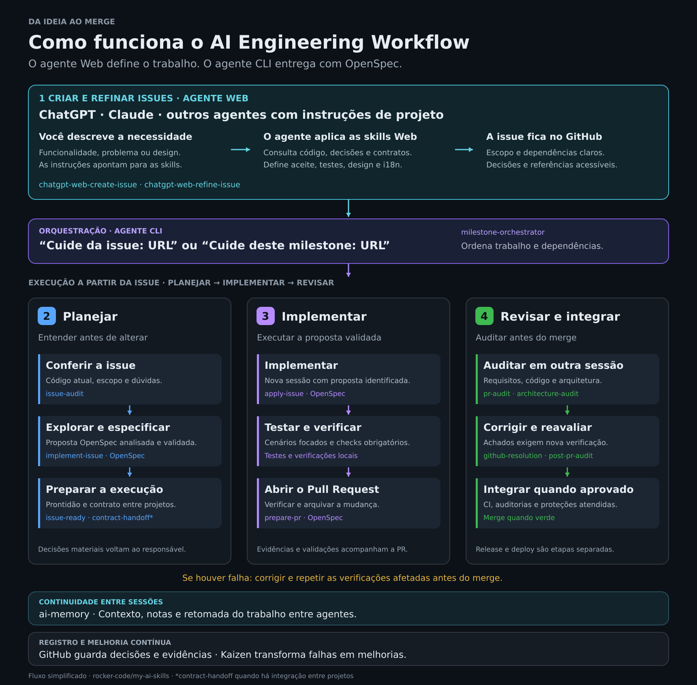

O diagrama acima usa diretamente a fonte SVG editável. Para exportar uma versão PNG, execute `inkscape docs/images/fluxo-my-ai-skills.svg --export-type=png --export-filename=docs/images/fluxo-my-ai-skills.png`.

### O fluxo em um olhar

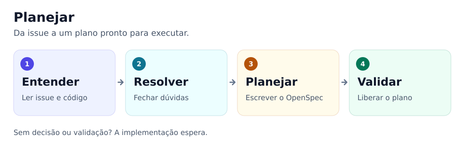

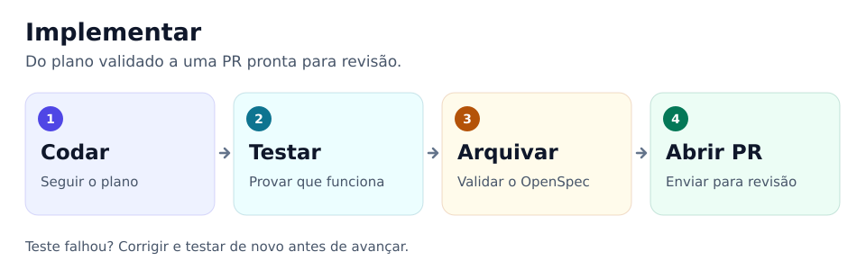

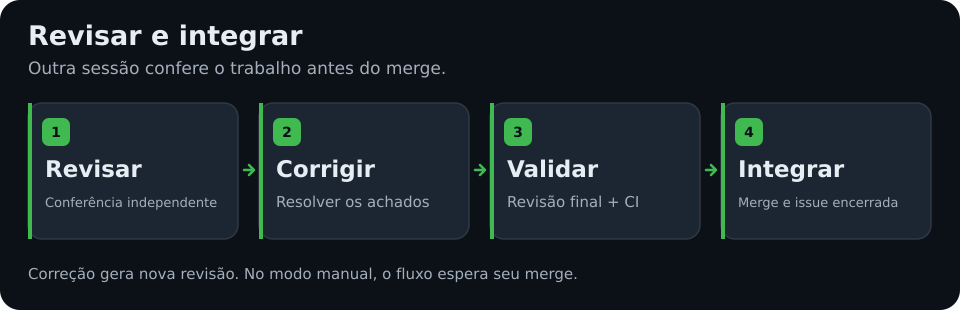

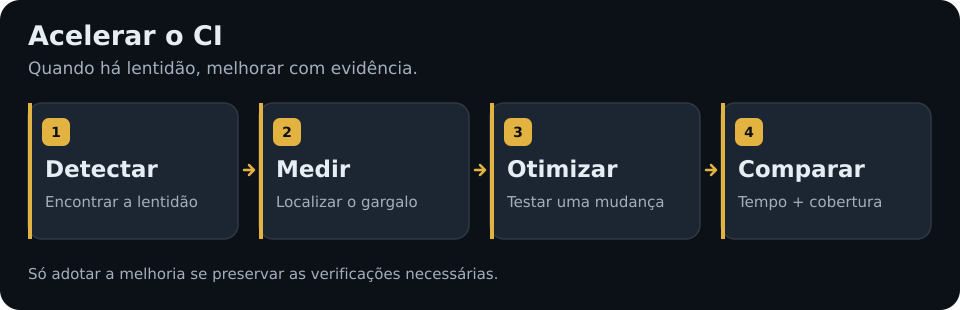

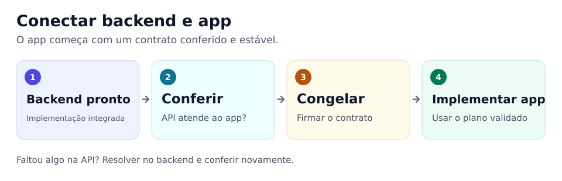

<details>
<summary>Detalhes técnicos, skills e regras de cada etapa</summary>

### Referência técnica dos fluxos

Leia cada diagrama de cima para baixo. Caixas descrevem ações; losangos indicam decisões. As skills responsáveis aparecem abaixo de cada fluxo, permitindo entender a sequência sem conhecer os comandos instalados. As visões resumem o fluxo existente; validações, sessões independentes e regras do repositório continuam obrigatórias.

#### 1. Da issue à entrega

Comece por uma issue, pela fila do repositório ou por um milestone. O orquestrador aplica o mesmo ciclo de entrega a cada issue elegível.

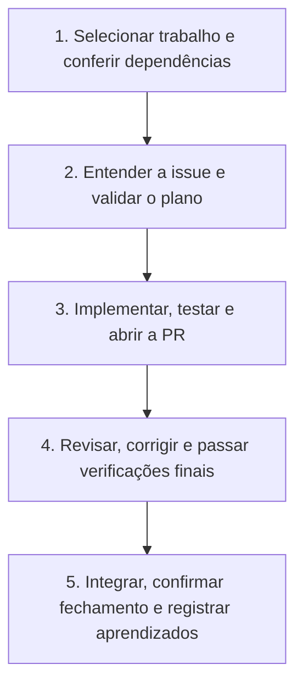

| Parte do fluxo | Skills responsáveis |
|---|---|
| Coordenar o escopo selecionado e as dependências | `milestone-orchestrator` |
| Conferir a issue e validar seu plano | `issue-audit`, `implement-issue` |
| Implementar e preparar a PR | `apply-issue`, `prepare-pr` |
| Revisar e resolver achados | `pr-audit`, `github-resolution`, `post-pr-audit` |
| Registrar melhorias comprovadas após o merge | `kaizen` |

Issues independentes podem executar em paralelo, em sessões e árvores de trabalho isoladas. Dependências obrigatórias aguardam merges confirmados. Com **"sem merge"**, o ciclo para em **READY_TO_MERGE**, após revisão e verificações exigidas. Publicação de versões e implantação exigem pedido separado.

#### 2. Planejamento: entender antes de implementar

O agente de planejamento confere a issue contra o código atual, resolve informações ausentes e valida uma revisão exata da proposta OpenSpec. Ele continua automaticamente quando há evidências suficientes.

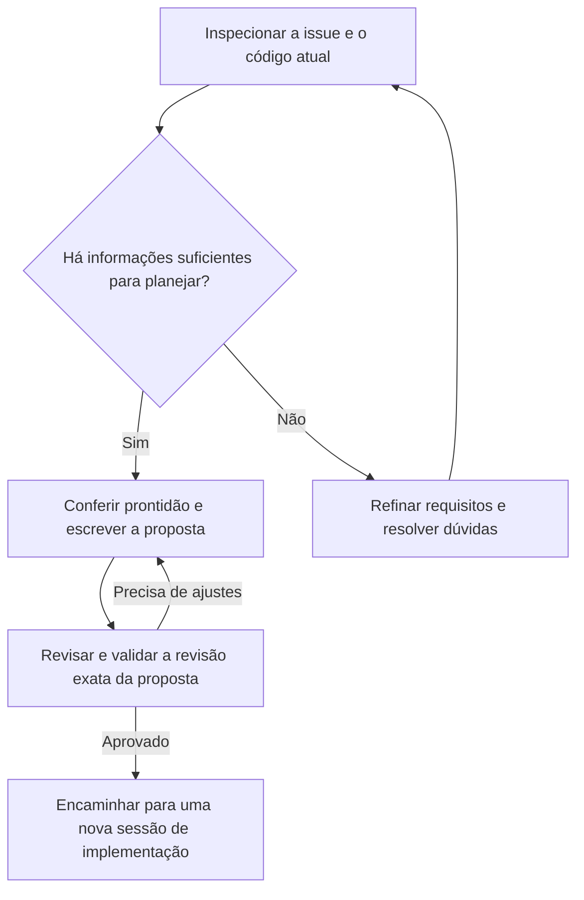

| Responsabilidade | Skills |
|---|---|
| Coordenar o planejamento | `implement-issue` |
| Verificar afirmações e explorar o comportamento atual | `issue-audit`, `issue-explore` |
| Refinar requisitos ou resolver questões relevantes | `refine-issue`, `resolve-questions` |
| Exigir prontidão e validação da proposta OpenSpec | `issue-ready`, `openspec-workflow` |
| Conferir regras de domínio quando aplicáveis | `magento-review`, `expo-mobile-review` |

Após decisões relevantes, a exploração se repete antes da declaração de prontidão. Questões rotineiras são resolvidas por evidências; decisões materiais de produto ou arquitetura ainda pendentes exigem participação do responsável e bloqueiam apenas o trabalho afetado. Falhas na validação mantêm a issue no planejamento.

#### 3. Implementação: transformar o plano validado em PR

A implementação começa em uma nova sessão, usando a proposta identificada e validada. Os testes comprovam critérios de aceite e riscos concretos; as verificações aplicáveis do repositório continuam obrigatórias.

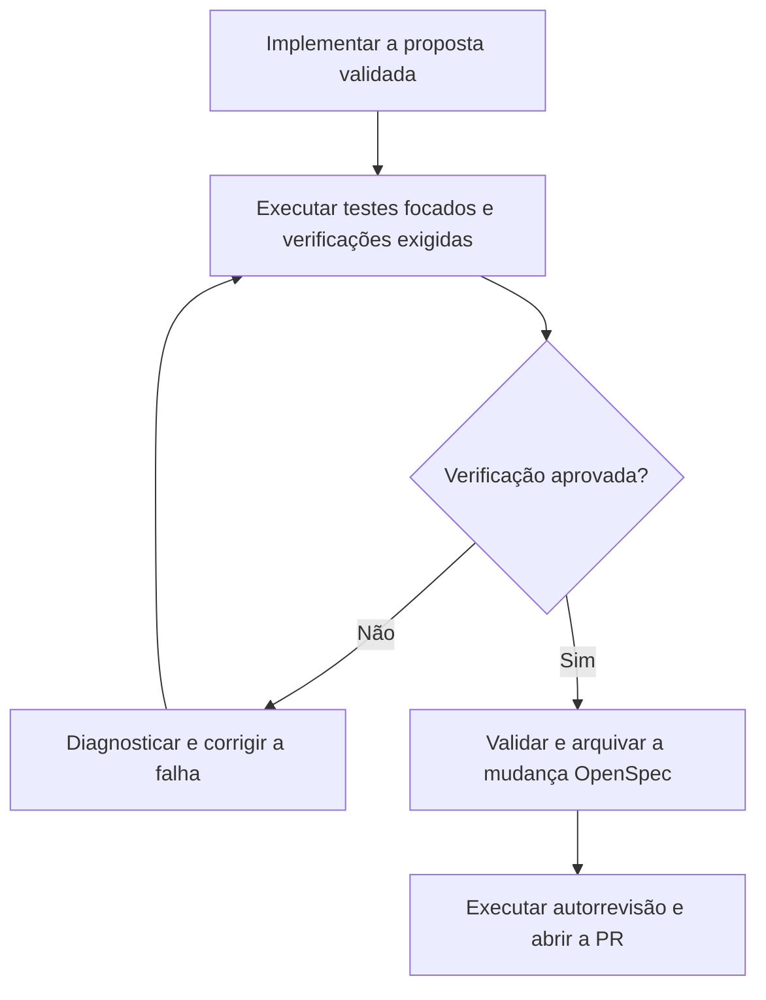

| Responsabilidade | Skills |
|---|---|
| Implementar e verificar em uma nova sessão | `apply-issue` |
| Exigir verificação, validação estrita e arquivamento | `openspec-workflow` |
| Executar a análise de qualidade aplicável | `sonar` |
| Preparar o commit e a PR com evidências | `prepare-pr` |

Em mudanças com muitas integrações, confira o ambiente e as massas de teste antes de uma execução cara. Comprove primeiro um cenário restrito e depois execute a suíte local completa exigida no commit candidato. Arquive somente após a verificação e a validação estrita passarem; inclua o arquivo e as especificações sincronizadas na mesma PR. Se novas evidências alterarem o contrato validado, retorne ao planejamento antes de continuar a implementação.

#### 4. Revisão: corrigir achados antes do merge

Uma revisão isolada relata achados. Correções e merge só ocorrem em uma execução de resolução autorizada.

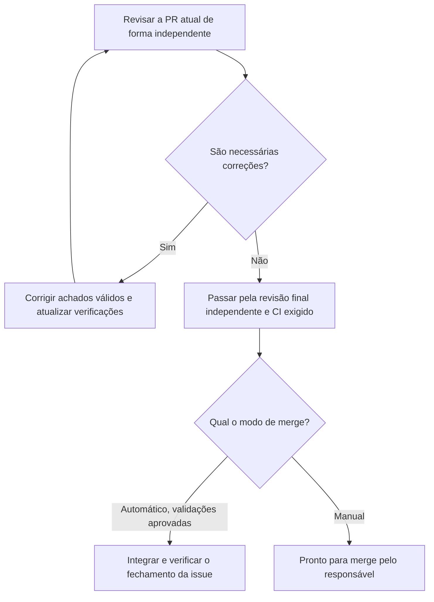

| Responsabilidade | Skills |
|---|---|
| Revisar requisitos, código e testes de forma independente | `pr-audit` |
| Conferir limites alterados e acoplamento quando aplicável | `architecture-audit` |
| Coordenar correções autorizadas e atualizar auditorias | `github-resolution` |
| Corrigir achados válidos da revisão | `address-pr-review` |
| Executar a validação final independente e o merge autorizado | `post-pr-audit` |
| Registrar aprendizados após merge e fechamento confirmados | `kaizen` |

Uma revisão final ou verificação de CI reprovada mantém a PR em revisão/correção. Um novo envio exige atualizar as evidências afetadas para a revisão atual do código. O merge automático nunca ignora verificações, revisões ou proteções de branch obrigatórias.

#### 5. Desempenho de CI: apoio às etapas existentes

O trabalho de desempenho é encaminhado automaticamente quando uma issue ou alteração aciona suas regras. Ele apoia planejamento, implementação e revisão dentro do ciclo de entrega.

| Quando é necessário | O que acontece | Skills |
|---|---|---|
| Uma issue relata pipeline lenta | Diagnosticar gargalos medidos antes de propor mudanças | `issue-audit` → `ci-performance-audit` |
| Planejar ou implementar melhoria de desempenho | Planejar um experimento limitado e comparar resultados | `implement-issue` / `apply-issue` → `optimize-ci` |
| Preparar ou revisar mudanças relevantes de CI/testes | Conferir evidências de desempenho e obrigações de teste preservadas | `prepare-pr` / `pr-audit` → `ci-performance-audit` |
| Lentidão recorrente comprovada após a entrega | Investigar se uma melhoria específica de processo é justificada | `kaizen` → `ci-performance-audit` |

Adições comuns de testes recebem uma verificação leve. `post-pr-audit` usa as evidências da revisão atual e não inicia automaticamente outra medição de desempenho.

#### 6. Backend para mobile: combinar o contrato primeiro

Os requisitos do consumidor são conferidos no planejamento. Após o merge da implementação do produtor, a entrega final do contrato verifica a API implementada antes do início da implementação do consumidor.

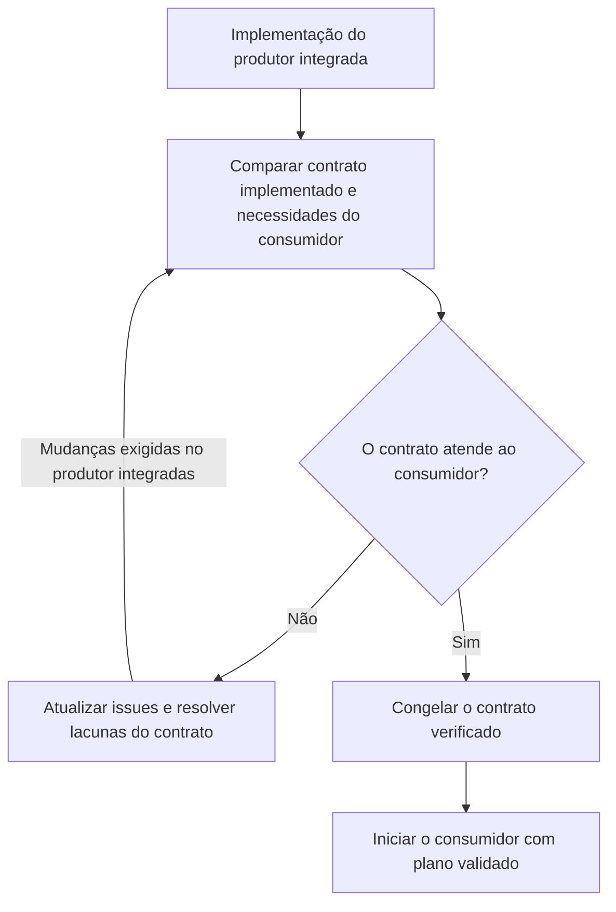

| Responsabilidade | Skills |
|---|---|
| Conferir cenários contra o produtor e congelar o contrato final | `contract-handoff` |
| Atualizar requisitos incompletos do produtor ou consumidor | `refine-issue` |
| Planejar e validar o trabalho do consumidor | `implement-issue` |
| Implementar somente após congelamento final e validação da proposta | `apply-issue` |

Capacidades ausentes no produtor tornam-se dependências obrigatórias. Se apenas a issue consumidora precisar de esclarecimento, atualize-a e repita a comparação; não é necessário alterar o produtor. Uma mudança de contrato após seu congelamento exige revisar a issue consumidora e repetir a entrega do contrato.

</details>

`pr-status` é uma ferramenta de consulta de status. `update-main` e `release` atendem pedidos explícitos de manutenção ou publicação de versões; o fluxo de milestone não publica versões nem implanta automaticamente.

Invocar `/prepare-pr` autoriza a skill a preparar e registrar em commit somente os arquivos da issue atual, enviar sua branch sem forçar e abrir a PR. Isso não autoriza merge. Um pedido explícito de apenas preparação mantém o trabalho local.

Após a implementação e os testes passarem, arquive a mudança OpenSpec concluída na branch da funcionalidade antes de `/prepare-pr`. O arquivo e as especificações vigentes sincronizadas pertencem à mesma PR da issue, evitando uma PR posterior apenas para arquivamento. Nas auditorias, revise a mudança validada em `openspec/changes/archive/` junto às especificações vigentes.

Comece com **"Cuide da issue: URL"** para uma issue, **"Cuide da issue: URL, sem merge"** para integração manual, **"Cuide da fila deste projeto"** para o repositório atual, **"Cuide da fila deste projeto, sem merges"** para impedir merges, ou **"Cuide deste milestone: URL"** para limitar o escopo. `milestone-orchestrator` executa uma vez para o escopo escolhido. Para uma issue, inventaria essa issue e sua PR vinculada verificada; para uma fila ou milestone, inventaria todas as issues selecionadas. Constrói um grafo de dependências e agenda trabalho independente em sessões e árvores de trabalho isoladas, serializando dependências obrigatórias e possíveis conflitos de arquivos. Revisa cada proposta OpenSpec elegível contra a issue e o código atual, valida seu SHA exato sem uma aprovação rotineira do responsável e executa automaticamente novas sessões de implementação, testes, verificação, arquivamento, preparação da PR, resolução, auditorias independentes e CI. O padrão é integrar quando tudo estiver aprovado, respeitando verificações, revisões e proteções de branch; "não faça merge" ou `merge_mode=manual` substitui esse padrão. Issues bloqueadas não interrompem trabalho independente. Se o ambiente não oferecer sessões filhas ou árvores de trabalho isoladas, o agente informa a capacidade ausente em vez de alegar automação completa.

A implementação de produção não começa enquanto houver questões bloqueantes ou antes da validação de prontidão do OpenSpec. Mudanças relevantes exigem uma segunda exploração após as decisões.

## Skills

### Fluxo compartilhado

| Skill | Responsabilidade |
|---|---|
| `milestone-orchestrator` | Executar uma issue, a fila atual ou um milestone; revisar e validar propostas OpenSpec identificadas, agendar executores isolados e integrar PRs elegíveis quando aprovadas por padrão. |
| `issue-explore` | Adicionar o protocolo supervisionado de perguntas/saídas do GitHub ao comando oficial `/opsx-explore`; não substitui o comando CLI. |
| `issue-ready` | Reler decisões e exigir a definição de prontidão. |
| `issue-audit` | Verificar as afirmações da issue contra o código atual antes da exploração. |
| `implement-issue` | Auditar, explorar, propor e validar a revisão OpenSpec exata; entregar para execução automaticamente, salvo decisão material pendente. |
| `apply-issue` | Implementar a revisão OpenSpec identificada e validada em uma nova sessão. |
| `openspec-workflow` | Exigir comandos oficiais do OpenSpec, revisão e validação exatas, verificação, validação estrita e arquivamento. |
| `prepare-pr` | Executar autorrevisão, validar e criar/preparar uma PR rastreável. |
| `pr-audit` | Conferir de forma independente as afirmações da PR, limites de confiança, requisitos, OpenSpec, código e testes; publicar achados quando autorizado. |
| `architecture-audit` | Conferir limites e novos acoplamentos sem exigir LikeC4. |
| `github-resolution` | Executar issues/PRs auditadas, corrigir achados válidos e encaminhar cada PR à auditoria final independente e ao merge autorizado. |
| `post-pr-audit` | Executar revisão final independente e validar elegibilidade de merge; integrar quando aprovado por padrão, salvo instrução contrária. |
| `update-main` | Avançar a branch local `main` com segurança após o merge, preservando alterações sem commit. |
| `release` | Publicar uma versão verificada conforme o histórico de mudanças e a política de versões do repositório, somente após CI aprovado no commit exato da versão. |
| `kaizen` | Transformar falhas comprovadas em melhorias específicas do projeto ou processo. |
| `address-pr-review` | Atualizar comentários de revisão, corrigir achados válidos e responder com evidências. |
| `pr-status` | Consultar e classificar o estado atual da PR e a próxima ação. |
| `contract-handoff` | Rastrear cenários do consumidor até os contratos do produtor no planejamento, registrar dependências obrigatórias para lacunas e congelar o contrato implementado antes do trabalho consumidor. |
| `visual-artifact-implementation` | Aplicar exportações visuais aprovadas anexadas às issues usando componentes nativos e evidências de verificação visual, sem fluxo separado. |

### Supervisão Web

As duas skills `chatgpt-web-*` oferecem instruções Markdown portáveis para **ChatGPT, Claude e outros agentes Web com instruções de projeto**. Os nomes atuais são mantidos por compatibilidade. É necessário acesso de leitura às instruções e aos repositórios; alterações de issues exigem conector GitHub autorizado ou integração equivalente. As instruções não instalam capacidades nativas automaticamente e não substituem a execução CLI. Consulte o [protocolo de issues Web](protocol/CHATGPT_WEB_ISSUES.md).


| Skill | Responsabilidade |
|---|---|
| `refine-issue` | Transformar uma ideia ou rascunho de issue em especificação implementável. |
| `resolve-questions` | Analisar comentários `[QUESTION]` e registrar respostas `[DECISION]` sustentadas por evidências. |
| `chatgpt-web-create-issue` | Supervisão Web: pesquisar contexto e criar issues detalhadas, vinculadas e prontas para implementação. |
| `chatgpt-web-refine-issue` | Supervisão Web: discutir e resolver dúvidas, refinar issues existentes e registrar decisões duráveis. |

### Configurar o projeto no agente Web

Para usar as duas skills nas conversas do projeto, mantenha o conector GitHub disponível com acesso ao `rocker-code/my-ai-skills` e aos repositórios de destino. Copie o bloco abaixo para as **instruções do projeto no agente Web** (ChatGPT, Claude ou equivalente). Ele orienta a consulta das instruções atuais no GitHub; não instala skills automaticamente nem altera as configurações da conta por si só.

Não é necessário anexar os arquivos das skills a cada conversa quando o conector consegue lê-los. As regras detalhadas ficam nos protocolos versionados: alterações passam a ser consultadas após o merge em `main`. Atualize este bloco nas configurações se o próprio texto de encaminhamento mudar. Se a leitura pelo conector falhar, o agente deve informar quais fontes não conseguiu consultar, sem afirmar que aplicou a versão atual.

O mesmo texto pode ser usado nas instruções de projeto do ChatGPT, Claude ou de outro agente que aceite descrições persistentes do projeto. A capacidade depende do ambiente: ler instruções não concede acesso ao GitHub nem permissão para criar issues. Se não houver integração de escrita, o agente pode preparar um rascunho, informando que a publicação não foi realizada.

#### Instruções para copiar

```text
# Rocker Code — Instruções do Projeto

Este projeto utiliza https://github.com/rocker-code/my-ai-skills como referência
para engenharia de software e gerenciamento de GitHub Issues.

## Skills do agente Web (ChatGPT, Claude ou equivalente)

Use estas instruções no ChatGPT, Claude ou outro agente com instruções de projeto.
Os nomes chatgpt-web-* são mantidos por compatibilidade. É necessário acesso de
leitura às fontes; alterações de issues exigem integração GitHub autorizada.

No início de cada tarefa de criação ou revisão de issues, consulte pela integração
GitHub disponível a versão atual em main da skill correspondente e do protocolo compartilhado:

- Criação: skills/chatgpt-web-create-issue/SKILL.md
- Revisão/refinamento: skills/chatgpt-web-refine-issue/SKILL.md
- Protocolo: protocol/CHATGPT_WEB_ISSUES.md
- Design visual, quando aplicável: protocol/VISUAL_ARTIFACTS.md

Leia também as referências necessárias indicadas nesses arquivos. Reutilize a
leitura dentro da mesma tarefa; atualize-a se houver mudança relevante. Se uma
fonte estiver inacessível, informe a limitação e não invente seu conteúdo.

## Regras

- Aplique a skill conforme a solicitação, sem exigir comandos especiais.
- Consulte issues, comentários, decisões, PRs e código relevante; identifique a
  revisão inspecionada e o que já existe para evitar trabalho duplicado.
- Preserve os padrões dos projetos Magento, Mobile e App Operacional. Distinga
  fatos verificados, decisões aprovadas, propostas e questões abertas.
- Abra a issue com um resumo simples: o que muda, onde muda e de que depende.
  Defina comportamento esperado, escopo, fora do escopo e critérios observáveis.
- Inclua cenários de teste em tabela com preparação/ação, resultado esperado e
  camada sugerida. Priorize riscos reais, reutilize testes e massas de teste e evite
  matrizes exaustivas ou cobertura duplicada.
- Em integrações, documente a assinatura atual e a esperada, exemplos, estados,
  erros, autorização e dependências entre produtor e consumidor. Identifique
  contratos propostos como não implementados/não congelados; registre a
  assinatura efetiva após o entrega do contrato antes da integração final.
- Para backend, integração ou arquitetura, inclua system design Mermaid simples,
  com responsabilidades e fluxo dos dados verificáveis.
- Para interfaces, inclua esboço em caracteres em bloco text, principais estados
  e ações, além de referências visuais aprovadas, acessíveis e versionadas quando
  houver design. Valores ilustrativos não são dados reais. Siga VISUAL_ARTIFACTS.md;
  um link privado de Claude Artifacts sozinho não comprova acesso ao design.
- Quando houver conteúdo apresentado ao usuário, inclua i18n e tradução conforme
  o mecanismo e locale do projeto: textos, estados, erros, acessibilidade, datas,
  números, moeda e plurais. Defina quem traduz os textos da API; não exponha enums
  ou chaves cruas. Preserve nomes/dados de domínio e preveja fallback traduzido
  seguro para códigos desconhecidos, com critérios e testes representativos.
- Mantenha comportamento, design, esboço, contrato, critérios e testes coerentes.
  Ajustes pontuais devem preservar o conteúdo e as decisões fora de seu escopo.
- Explique questões técnicas e alternativas de forma simples quando houver uma
  decisão material pendente do usuário. Resolva detalhes rotineiros por evidências
  e não peça confirmações extras para ações já solicitadas ou autorizadas.
- Registre decisões aprovadas nas issues quando solicitado. Verifique as alterações
  no GitHub antes de afirmar sucesso e forneça os links e bloqueios restantes.
- Não implemente código ao criar/refinar issues; a execução segue o fluxo CLI com
  OpenSpec. Não invente código inspecionado, contratos, anexos ou testes executados.

## Forma de trabalho

Aceite pedidos naturais como:
- "Crie uma issue para..."
- "Analise a issue #123."
- "Responda à dúvida desta issue."
- "Revise as issues do milestone."
- "Atualize a especificação considerando o design anexado."

Não exija que o usuário repita estas instruções.
```

#### Padrão esperado nas issues

| Situação | Conteúdo esperado |
|---|---|
| Toda issue | Resumo, comportamento esperado, limites, critérios de aceite e cenários de teste proporcionais. |
| Implementação existente | Situação atual com evidências/revisão, componentes e testes a reutilizar ou atualizar. |
| API ou integração | Contrato atual → esperado, exemplos, estados/erros, responsabilidades e ordem de entrega. |
| Backend, integração ou arquitetura | System design Mermaid legível em um olhar. |
| Interface | Wireframe em caracteres e referência aprovada/versionada quando disponível, com estados e ações relevantes. |
| Texto apresentado ao usuário | Seção de i18n/tradução, responsabilidade app/API, formatação local e validação representativa. |

As seções são condicionais e seguem o [protocolo compartilhado](protocol/CHATGPT_WEB_ISSUES.md). O agente Web prepara e refina o backlog; o agente CLI continua responsável pela exploração, validação OpenSpec, implementação, testes e PR. Configurar o bloco acima é uma ação do usuário; uma PR neste repositório não atualiza as instruções de projetos já existentes no ChatGPT, Claude ou outro agente Web.

### Verificações de domínio

| Skill | Responsabilidade |
|---|---|
| `magento-review` | Conferir arquitetura e implementação Adobe Commerce/Magento, incluindo reutilização nativa e concorrência. |
| `expo-mobile-review` | Conferir navegação, estado, GraphQL, resiliência, acessibilidade e testes de ponta a ponta em Expo/React Native. |
| `sonar` | Executar análise de qualidade e segurança SonarQube independente de agente, busca de segredos, classificação e evidências de correção. |

### Aplicar designs aprovados

Anexe à issue a exportação aprovada e versionada do Claude Artifact (ZIP ou arquivos acessíveis) e capturas de referência. Inclua o link original como contexto opcional, as telas de destino e os comportamentos que devem ser preservados. Depois use **"Cuide da issue: URL"**. `issue-audit` e `apply-issue` aplicam automaticamente o [protocolo de artefatos visuais](protocol/VISUAL_ARTIFACTS.md), planejamento OpenSpec, componentes nativos e verificação representativa. Links privados inacessíveis e falta de ferramentas visuais devem ser informados, sem suposições.

## Protocolo GitHub

Marcadores de discussão:

```text
[QUESTION]
[DECISION]
[IMPLEMENTATION NOTE]
[RESOLVED]
```

Severidades de revisão:

```text
[BLOCKER]
[MUST FIX]
[SHOULD FIX]
[NICE TO HAVE]
```

A cobertura segue [TEST_STRATEGY.md](protocol/TEST_STRATEGY.md) automaticamente no planejamento, implementação e revisão. Os agentes selecionam cenários representativos a partir dos critérios de aceite e riscos concretos, reutilizam massas de teste e evitam duplicar toda a matriz de regras em testes unitários, integrados e GraphQL. Revisores devem justificar testes extras pela falha que as evidências atuais não detectariam. As verificações exigidas continuam obrigatórias; falhas repetidas exigem diagnóstico, não tentativas cegas. Nenhuma instalação extra de skill ou etapa de aprovação é necessária. Testes existentes do comportamento afetado também são avaliados por redundância ou expectativas obsoletas. Uma simplificação ampla da suíte é uma tarefa dedicada e medida, preservando a comprovação de cada teste consolidado, migrado ou removido.

Consulte [AI_WORKFLOW.md](protocol/AI_WORKFLOW.md), [GITHUB_CONVENTIONS.md](protocol/GITHUB_CONVENTIONS.md), [REVIEW_POLICY.md](protocol/REVIEW_POLICY.md) e [CI_PERFORMANCE.md](protocol/CI_PERFORMANCE.md) para as regras oficiais.

## Scripts auxiliares

Os scripts de contexto exigem `gh` e `jq`; os scripts de tempo exigem Python 3.10+ e acesso pelo GitHub CLI. `workflow-event` atualiza um comentário estruturado oculto por issue/execução; `workflow-report` apenas consulta:

```bash
scripts/issue-context https://github.com/owner/repo/issues/123
scripts/pr-context https://github.com/owner/repo/pull/124
scripts/workflow-status https://github.com/owner/repo/issues/123
scripts/workflow-event new-run-id
scripts/workflow-report https://github.com/owner/repo/issues/123
```

### Métricas de tempo

O orquestrador cria um identificador de execução compartilhado e usa `workflow-event` nas transições reais entre etapas de validação. Mantém um comentário estruturado oculto por issue/execução; cada evento atualiza esse comentário em vez de publicar outro. Para um milestone, inicialize todas as issues selecionadas com o mesmo identificador, inclusive bloqueadas ou em fila. Registre início/fim das etapas e início/fim explícitos das esperas. Retrabalho só é registrado quando uma etapa já concluída precisa ser refeita por achado de revisão, verificação reprovada, replanejamento ou reabertura.

```bash
RUN_ID=$(scripts/workflow-event new-run-id)
scripts/workflow-event run-start --issue https://github.com/owner/repo/issues/123 \
  --run-id "$RUN_ID" --scope single_issue --agent codex
scripts/workflow-event stage-start --issue https://github.com/owner/repo/issues/123 \
  --run-id "$RUN_ID" --stage issue_audit --worker-id orchestrator --agent codex
scripts/workflow-event stage-end --issue https://github.com/owner/repo/issues/123 \
  --run-id "$RUN_ID" --stage issue_audit --worker-id orchestrator --status completed
scripts/workflow-event run-end --issue https://github.com/owner/repo/issues/123 \
  --run-id "$RUN_ID" --status completed

scripts/workflow-report https://github.com/owner/repo/issues/123
scripts/workflow-report https://github.com/owner/repo/milestone/7 --run-id "$RUN_ID"
scripts/workflow-report https://github.com/owner/repo/milestone/7 --format json
scripts/workflow-report https://github.com/owner/repo/milestone/7 --format csv
```

Nos eventos de espera, informe a etapa e um motivo: `owner_input`, `dependency`, `ci`, `review`, `runtime_capacity`, `external` ou `other`. Para retrabalho, use `--reason review|ci|replan|reopened|other` e vincule evidências com `--evidence` (URL do GitHub ou SHA de commit). Valores opcionais de agente/modelo só são registrados quando o ambiente os fornece. Não inclua prompts ou dados sensíveis.

O relatório mostra o tempo de ciclo da issue, trabalho registrado, esperas explícitas, etapas, retrabalho, achados de revisão e verificações reprovadas/pendentes. No milestone, inclui contagens por estado e medianas por etapa; apresenta P90 apenas com pelo menos cinco amostras. Use `--run-id` para consultar uma execução comum do milestone. A soma do trabalho pode superar o tempo de calendário quando há execução paralela. Trabalho registrado é tempo de relógio dentro das etapas, descontadas as esperas explícitas, e não tempo de raciocínio interno do modelo. Dados ausentes são informados como indisponíveis, nunca inferidos de labels ou conversas.

As métricas apoiam `kaizen`: após a conclusão, compare gargalos recorrentes com retrabalho e evidências de qualidade antes de sugerir mudanças no processo. Uma execução lenta isolada não justifica alterar uma etapa de validação. Tokens e custos não são estimados quando o ambiente não os fornece.


Os auxiliares de contexto normalizam os dados atuais do GitHub para que os agentes atualizem comentários, decisões, revisões e CI em vez de depender de conversas antigas.

## Instalação passo a passo

Use o terminal no repositório da aplicação em que os agentes vão trabalhar. Os exemplos usam Bash (Linux, macOS ou Git Bash) e OpenCode; substitua `opencode` por `codex` ou `claude-code` conforme seu agente.

### 1. Conferir pré-requisitos e acesso ao GitHub

Instale Git, Node.js/npm compatíveis com os [requisitos do OpenSpec](https://github.com/Fission-AI/OpenSpec), GitHub CLI, jq, Python 3.10+ e o agente escolhido. Confira:

```bash
git --version
node --version
npm --version
gh --version
jq --version
gh auth status
```

Se o GitHub CLI não estiver autenticado, execute `gh auth login` neste ambiente. O acesso a repositórios privados precisa estar disponível tanto para o instalador quanto para o agente executor. Os auxiliares usam a autenticação do GitHub CLI; agentes Web precisam de sua própria conexão ao GitHub.

### 2. Instalar as skills para seu agente

Na raiz do repositório da aplicação:

```bash
cd /path/to/your-project
npx skills add rocker-code/my-ai-skills --skill '*' -a opencode -y
```

Isso instala todas as skills para o agente selecionado no escopo do projeto. Para uma instalação pessoal compartilhada entre projetos, use:

```bash
npx skills add rocker-code/my-ai-skills --skill '*' -a opencode -g -y
```

Escolha o escopo conscientemente. Para vários agentes, informe `-a opencode -a codex -a claude-code`. Use `--skill '*'` para selecionar todas as skills desses agentes; `--all` seleciona todas as skills **e todos os agentes**. Consulte a [documentação do CLI de skills](https://github.com/vercel-labs/skills).

Para uma instalação parcial, repita `--skill <name>`. Instale também as skills chamadas pelo fluxo escolhido, além da skill de entrada; instalar somente `milestone-orchestrator` não instala todos os executores automaticamente.

### 3. Inicializar OpenSpec no repositório da aplicação

As skills exigem OpenSpec, mas não instalam seu CLI nem inicializam o projeto:

```bash
npm install -g @fission-ai/openspec@latest
openspec --version
openspec init
```

Selecione o agente executor no inicializador. Se o projeto já estiver inicializado, confira a configuração existente e use `openspec update` para atualizar as integrações geradas, sem recriar a configuração. Preserve as instruções e configurações específicas do repositório.

Use os comandos gerados para seu agente: a sintaxe pode variar entre agentes e versões do OpenSpec. A skill `openspec-workflow` verifica os comandos oficiais disponíveis na versão instalada. Consulte o [guia de início do OpenSpec](https://github.com/Fission-AI/OpenSpec/blob/main/docs/getting-started.md).

### 4. Obter os arquivos complementares

O instalador de skills copia seus diretórios e referências embarcadas. Ele **não** copia `protocol/`, `templates/` ou `scripts/` da raiz do repositório para a aplicação.

Clone a fonte uma vez em um local separado. Mantenha o terminal no repositório da aplicação:

```bash
MY_AI_SKILLS_SOURCE="$HOME/.local/share/my-ai-skills"
mkdir -p "$(dirname "$MY_AI_SKILLS_SOURCE")"
gh repo clone rocker-code/my-ai-skills "$MY_AI_SKILLS_SOURCE"
```

Se já houver um clone, defina `MY_AI_SKILLS_SOURCE` com seu caminho absoluto e pule o comando de clonagem.

### 5. Copiar protocolos, modelos e auxiliares para o projeto

Este guia usa `.ai-workflow/` para cópias visíveis no projeto. É uma convenção documentada de instalação, não um caminho criado automaticamente pelo instalador de skills.

```bash
mkdir -p .ai-workflow/protocol .ai-workflow/templates .ai-workflow/scripts
cp "$MY_AI_SKILLS_SOURCE"/protocol/*.md .ai-workflow/protocol/
cp -R "$MY_AI_SKILLS_SOURCE"/templates/. .ai-workflow/templates/
cp "$MY_AI_SKILLS_SOURCE"/scripts/issue-context .ai-workflow/scripts/
cp "$MY_AI_SKILLS_SOURCE"/scripts/pr-context .ai-workflow/scripts/
cp "$MY_AI_SKILLS_SOURCE"/scripts/workflow-status .ai-workflow/scripts/
cp "$MY_AI_SKILLS_SOURCE"/scripts/workflow-event .ai-workflow/scripts/
cp "$MY_AI_SKILLS_SOURCE"/scripts/workflow-report .ai-workflow/scripts/
cp "$MY_AI_SKILLS_SOURCE"/scripts/workflow_metrics.py .ai-workflow/scripts/
chmod +x .ai-workflow/scripts/issue-context \
  .ai-workflow/scripts/pr-context \
  .ai-workflow/scripts/workflow-status \
  .ai-workflow/scripts/workflow-event \
  .ai-workflow/scripts/workflow-report
```

| Arquivos instalados | Finalidade |
|---|---|
| `protocol/AI_WORKFLOW.md` | Ciclo de trabalho, prontidão e validações da implementação. |
| `protocol/GITHUB_CONVENTIONS.md` | Convenções duráveis para issues, decisões e PRs. |
| `protocol/REVIEW_POLICY.md` | Severidades de revisão e regras de evidência. |
| `protocol/CI_PERFORMANCE.md` | Otimização medida e preservação das obrigações de CI. |
| `protocol/TEST_STRATEGY.md` | Cobertura por risco, camadas de comprovação, diagnóstico e critérios de parada. |
| `templates/pull-request.md`, `templates/github/*.md` | Formatos de PR, pergunta, decisão, revisão e contrato de integração. |
| `scripts/issue-context`, `scripts/pr-context`, `scripts/workflow-status` | Consulta de contexto atual do GitHub; exige `gh` e `jq`. |
| `scripts/workflow-event`, `scripts/workflow-report`, `scripts/workflow_metrics.py` | Registro opcional de tempos e relatórios por issue/milestone; exige `gh` e Python 3.10+. |

`scripts/sync-plugin` mantém o pacote deste repositório. Não o instale como auxiliar de execução da aplicação.

As referências embarcadas nas skills já contêm os protocolos e modelos aplicáveis. As cópias no projeto tornam essas regras e ferramentas acessíveis à equipe; copiá-las, por si só, não registra skills no agente.

### 6. Vincular as instruções do projeto aos arquivos instalados

Acrescente a orientação abaixo ao `AGENTS.md` existente (ou ao arquivo de instruções efetivamente lido pelo agente), adaptando-a às regras do projeto. Preserve as instruções existentes; não substitua o arquivo:

```markdown
## Fluxo de desenvolvimento com IA

Use o fluxo my-ai-skills instalado para trabalho orientado por issues.
Leia .ai-workflow/protocol/AI_WORKFLOW.md,
.ai-workflow/protocol/GITHUB_CONVENTIONS.md e
.ai-workflow/protocol/REVIEW_POLICY.md e
.ai-workflow/protocol/TEST_STRATEGY.md antes de executar esse fluxo.
Para trabalho de CI ou desempenho de testes, leia também
.ai-workflow/protocol/CI_PERFORMANCE.md.

Use .ai-workflow/templates/ para os formatos compartilhados de saída.
Atualize as evidências do GitHub com .ai-workflow/scripts/issue-context,
.ai-workflow/scripts/pr-context e .ai-workflow/scripts/workflow-status.
Preserve as restrições do projeto, o escopo e o modo de merge escolhidos pelo usuário.
```

Para Claude Code, coloque a orientação no `CLAUDE.md` ou referencie o arquivo compartilhado de instruções. Registre instruções, protocolos, modelos e auxiliares em commit se a instalação for destinada à equipe.

### 7. Verificar e iniciar o fluxo existente

```bash
npx skills list
test -f .ai-workflow/protocol/CI_PERFORMANCE.md
test -f .ai-workflow/protocol/TEST_STRATEGY.md
test -x .ai-workflow/scripts/issue-context
test -x .ai-workflow/scripts/pr-context
test -x .ai-workflow/scripts/workflow-status
test -x .ai-workflow/scripts/workflow-event
test -x .ai-workflow/scripts/workflow-report
test -f .ai-workflow/scripts/workflow_metrics.py
python3 --version
.ai-workflow/scripts/issue-context https://github.com/owner/repo/issues/123
```

Substitua a URL de exemplo por uma issue acessível. Para skills globais, confira também `npx skills list -g`. Reinicie o agente ou abra uma nova sessão para que ele descubra as skills instaladas.

Comece com **"Cuide da issue: URL"**, **"Cuide da fila deste projeto"** ou **"Cuide deste milestone: URL"**. O fluxo de entrada encaminha automaticamente às skills de apoio nas condições documentadas; não é necessário invocar cada caixa do diagrama. Carregar skills não cria um agendador em segundo plano: é preciso iniciar uma execução e o ambiente deve oferecer as ferramentas e sessões isoladas exigidas.

### 8. Manter a instalação atualizada

Atualize o clone da fonte complementar:

```bash
git -C "$MY_AI_SKILLS_SOURCE" pull --ff-only
```

Depois repita a etapa 2 para o agente/escopo escolhido e a etapa 5 para os arquivos copiados. Revise as diferenças antes do commit: a cópia sobrescreve os arquivos gerenciados, portanto mantenha acréscimos específicos do projeto em arquivos separados. Revise mudanças de protocolo junto às referências embarcadas. Em um novo terminal, defina `MY_AI_SKILLS_SOURCE` novamente com o caminho do clone existente.

## Instalar como plugin pessoal do ChatGPT/Codex

O repositório também contém um plugin independente de skills em `plugins/my-ai-skills` e um catálogo em `.agents/plugins/marketplace.json`.

Adicione o catálogo uma vez:

```bash
codex plugin marketplace add rocker-code/my-ai-skills --ref main
```

Instale o plugin:

```bash
codex plugin add my-ai-skills@rocker-code-ai
```

No aplicativo desktop do ChatGPT, reinicie o app, abra o diretório de plugins, selecione o catálogo **Rocker Code AI** e instale **Rocker Code AI Workflow**. Abra uma nova conversa após a instalação para carregar as skills.

O plugin é pessoal e não precisa ser enviado ao diretório público. Publicá-lo em um espaço de trabalho do ChatGPT é uma ação administrativa separada.

Os diretórios `skills/`, `protocol/`, `templates/` e os scripts auxiliares na raiz continuam sendo a fonte oficial usada pelo `skills.sh`. Suas cópias em `plugins/my-ai-skills/` formam o pacote independente do plugin. Skills que referenciam protocolos ou modelos compartilhados recebem uma cópia gerada em seu próprio diretório `references/`, pois `skills.sh` instala apenas o diretório da skill. Após alterar arquivos oficiais, regenere as cópias e sincronize o pacote:

```bash
scripts/sync-plugin
```

## Cuidar de uma issue

Use um dos pedidos:

```text
Cuide da issue: https://github.com/owner/repo/issues/123
Cuide da issue: https://github.com/owner/repo/issues/123, sem merge
```

O mesmo `milestone-orchestrator` atende à entrada com `scope=single_issue`; não é necessário outro nome de skill ou sequência manual. Ele audita, planeja/valida OpenSpec, implementa em nova sessão, verifica/arquiva, prepara a PR, revisa de forma independente, corrige achados e chega a merge/conclusão/kaizen quando todas as validações passam. O segundo pedido para em `READY_TO_MERGE`.

Uma proposta ou PR de implementação existente é retomada a partir das evidências atuais. Issues relacionadas são consultadas como dependências e não executadas automaticamente. Uma dependência obrigatória sem merge, decisão material pendente ou capacidade ausente do ambiente é informada como bloqueio. Uma issue fechada é inspecionada e relatada sem reabertura. O encaminhamento automático de desempenho de CI também se aplica aqui.

## Regras de milestones

- Invoque com a fila do repositório atual ou um milestone identificável. A primeira saída é um inventário de dependências e o próximo trabalho desbloqueado, com evidências para a ordem proposta.
- O estado é reconstruído a partir de decisões da issue, revisão OpenSpec registrada em commit, revisão atual da PR, revisões e CI. Um status inferido por ferramenta ou resumo do ai-memory não comprova validação da proposta nem decisão de produto.
- Agende trabalho independente por dependência e risco de conflito, usando sessões e árvores de trabalho isoladas. Aguarde pré-requisitos com merge para trabalhos dependentes. Resolva ciclos de dependência e vínculos incertos antes de executar o trabalho afetado.
- O agente revisa e valida a proposta OpenSpec identificada; a participação do responsável fica reservada a decisões materiais pendentes. O padrão é integrar quando tudo estiver aprovado após a revisão final e verificações exigidas; "não faça merge" ou `merge_mode=manual` substitui o padrão. O orquestrador não publica versões nem implanta.
- Se uma nova sessão de implementação não estiver disponível, preserve o plano registrado em commit e entregue instruções de continuidade para copiar. Uma execução interrompida ou reprovada retoma a última etapa comprovada.
- Merge da PR e fechamento da issue são verificados antes de kaizen. ghpending é opcional para triagem diária; GitHub Project é uma visão de planejamento do produto.

## Fluxo entre repositórios

Para trabalho backend → mobile:

1. faça merge das issues de contrato do backend;
2. execute `contract-handoff` contra o código final do backend e a issue mobile;
3. atualize a issue consumidora, se necessário;
4. declare `CONTRACT FROZEN`;
5. só então implemente o consumidor.

Se o contrato do produtor mudar após o congelamento, revise explicitamente a issue consumidora e repita a entrega do contrato.
## Otimização de CI

Os comandos existentes de fila e milestone encaminham automaticamente o trabalho relevante a duas skills de domínio:

| Skill | Responsabilidade |
|---|---|
| `ci-performance-audit` | Diagnosticar gargalos medidos e revisar de forma independente as evidências de otimização e a preservação das obrigações de CI. |
| `optimize-ci` | Orientar experimentos limitados pelas etapas existentes de planejamento OpenSpec, implementação em nova sessão e revisão. |

Não é necessária invocação manual. Issues de desempenho acionam diagnóstico/planejamento; mudanças relevantes em fluxos, massas de teste, preparação do ambiente ou seleção de testes acionam revisão proporcional; kaizen diagnostica lentidão recorrente comprovada. Adições comuns de testes recebem uma verificação leve, não uma medição hospedada obrigatória. Autoridade de agendamento e merge continua com o orquestrador e as skills de revisão.

Consulte [CI_PERFORMANCE.md](protocol/CI_PERFORMANCE.md). Compare tempo decorrido, minutos de execução e comprovação de comportamento; uma pipeline verde e mais rápida, sozinha, não comprova melhoria. Orientações específicas de Magento estão embarcadas em ci-performance-audit. Alterações nas fontes são sincronizadas ao plugin por `scripts/sync-plugin`.
